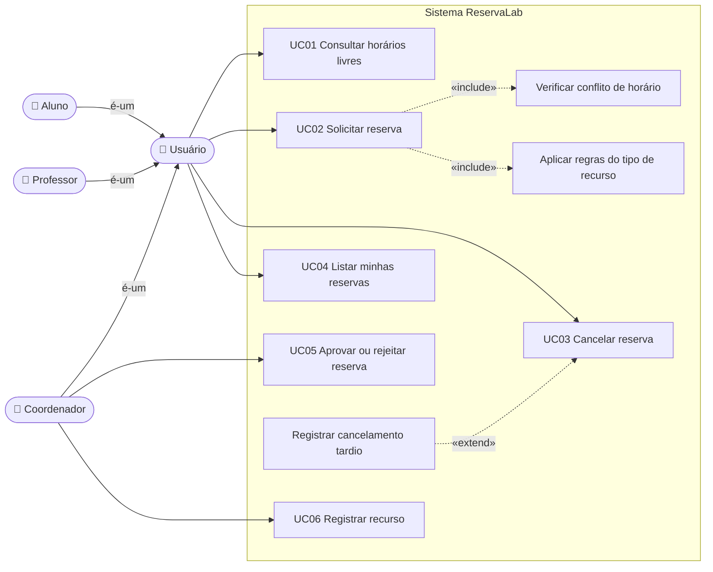
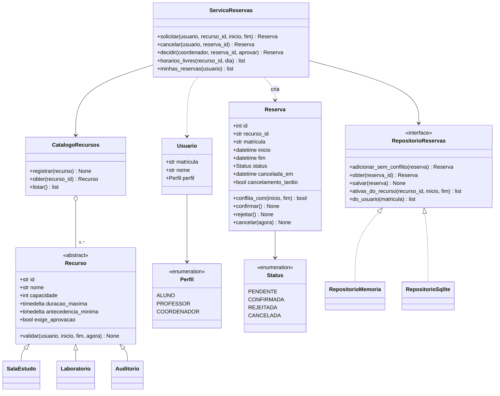
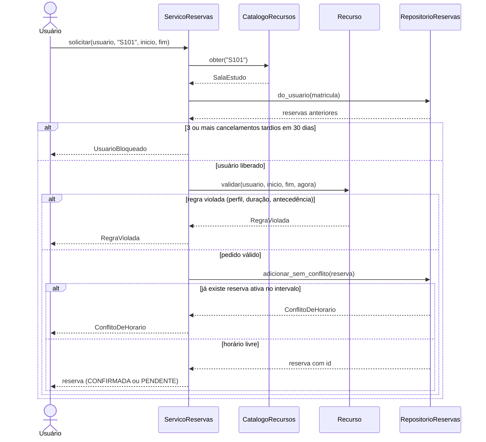
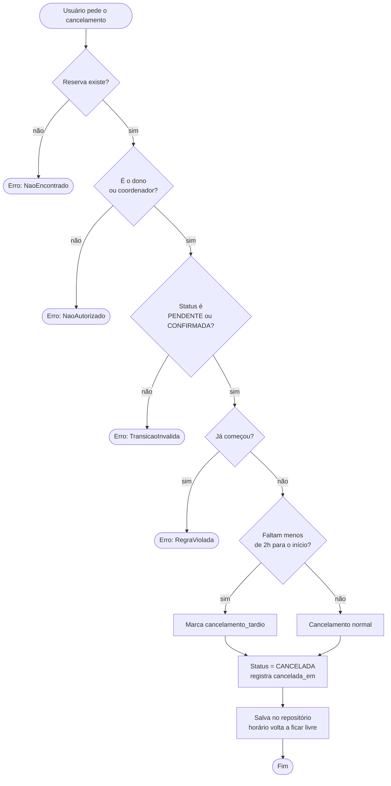
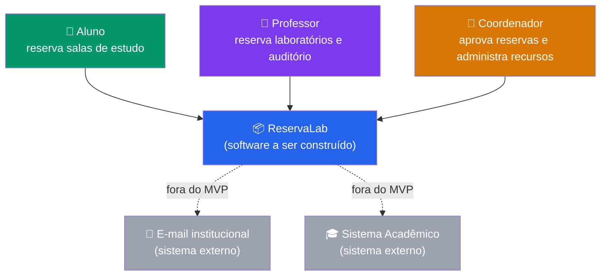
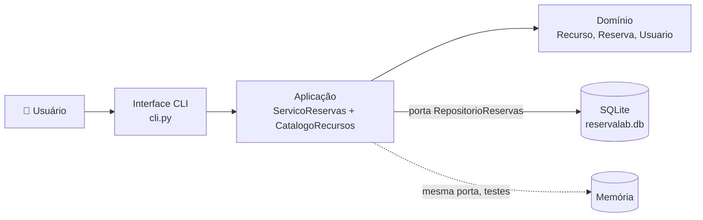

# A3 — Projeto Exemplo: ReservaLab  

> **Documento de referência** — Este projeto é um exemplo completo de A3 para a disciplina de Projeto e Engenharia de Software. Ele mostra o nível de profundidade e os artefatos esperados em cada critério da rubrica. Use-o como guia, **não como modelo a ser copiado**: o seu projeto deve refletir o problema e as decisões do seu grupo.  
>  
> **O que é real e o que é ilustrativo.** O código, os testes, os diagramas, os números de desempenho e o histórico do `git log` abaixo foram **produzidos e executados de verdade** (repositório completo em [`a3-reservalab`](https://github.com/giovanebarcelos/pes-sandbox/tree/main/class27/a3-reservalab)). O grupo, as entrevistas e os registros de uso de IA são **fictícios** e servem para mostrar o formato esperado. O exemplo foi elaborado pelo professor com apoio de IA (Claude Code); no seu projeto, a seção **Uso de IA** deve contar o que realmente aconteceu.  

---  

## Identificação do Projeto  

| Campo | Conteúdo |  
|---|---|  
| **Título** | ReservaLab — Reserva de salas, laboratórios e auditório do campus |  
| **Grupo** | Fred · Wilma · Barney · Betty |  
| **Período** | 2026/2 |  
| **Tema** | Sistema de reservas com regras por tipo de recurso |  
| **Linguagem e stack** | Python 3.12 · pytest · SQLite · Docker Compose · Mermaid |  
| **Repositório** | `github.com/<grupo>/reservalab` (tag `v1.0.0`) — exemplo em [`a3-reservalab`](https://github.com/giovanebarcelos/pes-sandbox/tree/main/class27/a3-reservalab) |  
| **Processo** | Kanban com limite de WIP (Aula 8) |  
| **Arquitetura** | Camadas com portas — hexagonal leve (Aulas 19-20) |  

---  

## 1. Contexto, Problema e Escolha do Tema  

### 1.1 O problema  

O campus tem salas de estudo, laboratórios e um auditório. Hoje as reservas são feitas numa planilha compartilhada e por mensagens à secretaria. Surgem três tipos de falha: **dois pedidos para o mesmo horário** (a planilha deixa digitar os dois), **regras esquecidas** (aluno reservando laboratório, auditório pedido na véspera) e **reservas fantasma** (quem reserva e não aparece, cancelando em cima da hora).  

**Pergunta central:** como garantir que nenhum recurso seja reservado duas vezes no mesmo horário, aplicando automaticamente as regras de cada tipo de recurso?  

### 1.2 Verificação do tema contra os critérios da A3  

| Critério | Como o ReservaLab atende |  
|---|---|  
| **Problema real e identificável** | Conflitos e reservas fantasma na planilha atual, relatados pela coordenação |  
| **Acesso a stakeholders** | Coordenação, 2 professores e 3 alunos entrevistados |  
| **Escopo viável** | 9 RF + 5 RNF; um sistema pequeno, **completo** e testado |  
| **Rende OO e arquitetura** | Hierarquia `Recurso` (herança + polimorfismo), `Reserva` com máquina de estados (encapsulamento), portas e adaptadores |  
| **Originalidade** | Regras próprias do campus (cancelamento tardio, bloqueio por reincidência), não uma cópia de tutorial |  

### 1.3 Partes interessadas  

| Parte interessada | Relação com o problema | Poder | Interesse | Estratégia |  
|---|---|---|---|---|  
| **Alunos** | Achar sala livre rápido | Baixo | Alto | Entrevistar; manter informados |  
| **Professores** | Garantir laboratório e auditório | Médio | Alto | Entrevistar; envolver na validação |  
| **Coordenação** | Controlar o auditório, coibir reservas fantasma | Alto | Alto | Gerenciar de perto; validar requisitos |  
| **Secretaria** | Deixar de intermediar pedidos | Baixo | Médio | Informar |  
| **TI do campus** | Integrar no futuro ao sistema acadêmico | Alto | Baixo | Manter satisfeita; deixar a persistência trocável (ADR-001) |  

### 1.4 Elicitação (Aula 10)  

Entrevistas semiestruturadas (6 pessoas) e observação da planilha atual. O que apareceu e onde virou requisito:  

| Achado | Virou |  
|---|---|  
| "Reservei e, quando cheguei, a sala estava ocupada." | RF-04 (sem sobreposição) e RNF-04 (sob concorrência) |  
| "Aluno não deveria poder pegar o laboratório." | RF-05 (perfil por tipo) |  
| "O auditório precisa passar por mim." | RF-05/RF-08 (aprovação) |  
| "Tem gente que cancela dez minutos antes, de novo e de novo." | RF-06/RF-07 (cancelamento tardio e bloqueio) |  
| "O que eu quero saber é: que horários estão livres amanhã?" | RF-02 (horários livres) |  

> *Dados de campo fictícios, apenas para ilustrar a rastreabilidade entre elicitação e requisito.*  

---  

## 2. Gestão do Projeto  

Documento completo no repositório: `docs/gestao.md`. Resumo:  

### 2.1 Processo escolhido e justificativa  

| Critério (Aula 8) | Situação do grupo | Efeito na escolha |  
|---|---|---|  
| Tamanho da equipe | 4 pessoas | Scrum completo (papéis, cerimônias) seria mais cerimônia que trabalho |  
| Disponibilidade | Variável: cada um tem trabalho e outras disciplinas | Sprint de tamanho fixo seria quebrada toda semana; fluxo contínuo absorve a variação |  
| Requisitos | Razoavelmente estáveis depois da validação com a coordenação (Aula 12) | Pouca necessidade de replanejar a cada ciclo |  
| Prazo | Fixo (entrega A3) | Exige visibilidade de gargalos — o quadro dá isso |  

**Decisão:** Kanban em quadro de *issues* do GitHub, colunas `Backlog → Fazendo → Revisão → Pronto`, **WIP = 2 em "Fazendo" por pessoa** e **WIP = 3 em "Revisão" no total** (revisão parada é o gargalo clássico de times pequenos). Reunião de 15 min por semana, na terça, para olhar o quadro.  

**Definição de pronto:** código com teste que passa, revisado por outro integrante, requisito/ADR/SDR atualizado se mudou, merge na `main` por *pull request*.  

### 2.2 EAP  

```  
1 ReservaLab  
├── 1.1 Requisitos         1.1.1 Entrevistas · 1.1.2 Documento de requisitos · 1.1.3 Validação  
├── 1.2 Modelagem          1.2.1 Casos de uso · 1.2.2 Classes · 1.2.3 Sequência e atividades  
├── 1.3 Arquitetura        1.3.1 ADRs · 1.3.2 SDR · 1.3.3 C4  
├── 1.4 Implementação      1.4.1 Domínio · 1.4.2 Aplicação · 1.4.3 Repositórios · 1.4.4 CLI  
├── 1.5 Qualidade          1.5.1 Testes · 1.5.2 Valores-limite e mutação · 1.5.3 Concorrência  
└── 1.6 Entrega            1.6.1 README e Uso de IA · 1.6.2 Pitch · 1.6.3 Ensaio e defesa oral  
```  

### 2.3 Riscos  

Probabilidade (P) e impacto (I) de 1 a 5; exposição = P × I.  

| ID | Risco | P | I | Exp. | Resposta | Gatilho |  
|---|---|---|---|---|---|---|  
| R1 | Regras de negócio mudarem depois de implementadas (coordenação muda o limite de horas) | 3 | 4 | 12 | **Mitigar:** regras em atributos de classe (`duracao_maxima`...), cobertas por teste de valor-limite | Pedido de mudança após a validação |  
| R2 | Duas reservas no mesmo horário por condição de corrida | 2 | 5 | 10 | **Mitigar:** operação atômica na porta (ADR-002) + teste com 20 threads | Teste de concorrência vermelho |  
| R3 | Limite diário do modelo gratuito do agente (≈ 50 req/dia, Aula 01B) travar a semana final | 4 | 3 | 12 | **Mitigar:** usar `caveman`, pedidos pequenos, não deixar IA para a última semana | 2 dias seguidos com cota estourada |  
| R4 | Integrante com pouca disponibilidade na reta final | 3 | 3 | 9 | **Mitigar:** programação em par nas partes críticas; todos revisam PR | Item parado > 5 dias em "Fazendo" |  
| R5 | Documento dizer algo que o código não faz (documentação gerada por IA e não conferida) | 3 | 4 | 12 | **Evitar:** matriz de rastreabilidade conferida por script; revisão humana de todo texto gerado | Teste citado na matriz que não existe |  

---  

## 3. Requisitos (Aulas 9-12)  

Documento completo: `docs/requisitos.md` (9 RF, 5 RNF, critérios de aceitação em Gherkin, matriz de rastreabilidade).  

### 3.1 Requisitos funcionais  

Prioridade MoSCoW: **M**ust, **S**hould, **C**ould.  

| ID | Requisito | Prior. | Origem |  
|---|---|---|---|  
| RF-01 | O sistema deve manter um catálogo de recursos (tipo, nome, capacidade); id repetido e capacidade < 1 são recusados | M | Coordenação |  
| RF-02 | O sistema deve mostrar, para um recurso e um dia, as faixas livres entre 08h e 22h | M | Aluno |  
| RF-03 | O sistema deve permitir solicitar reserva informando recurso, início e fim | M | Aluno, Professor |  
| RF-04 | O sistema não pode aceitar duas reservas ativas (pendente ou confirmada) sobrepostas no mesmo recurso; reservas que apenas se encostam (fim = início) são permitidas | M | Todos |  
| RF-05 | O sistema deve aplicar as regras do tipo de recurso: perfil permitido, duração máxima, antecedência mínima e necessidade de aprovação (tabela abaixo) | M | Coordenação |  
| RF-06 | O sistema deve permitir cancelar reserva ativa antes do início; cancelar com menos de 2h de antecedência é "cancelamento tardio" | M | Coordenação |  
| RF-07 | O sistema deve bloquear novas reservas de quem tem 3 ou mais cancelamentos tardios nos últimos 30 dias | S | Coordenação |  
| RF-08 | O sistema deve permitir que o coordenador aprove ou rejeite reservas pendentes | M | Coordenação |  
| RF-09 | O sistema deve listar as reservas de um usuário, da mais próxima para a mais distante | S | Aluno |  

**Regras por tipo (RF-05):**  

| Tipo | Perfis | Duração máx. | Antecedência mín. | Aprovação |  
|---|---|---|---|---|  
| Sala de estudo | todos | 2 h | 30 min | automática |  
| Laboratório | professor, coordenador | 4 h | 24 h | automática |  
| Auditório | professor, coordenador | 6 h | 72 h | coordenador |  

### 3.2 Requisitos não funcionais  

| ID | Categoria | Requisito (mensurável) | Prior. |  
|---|---|---|---|  
| RNF-01 | Desempenho | Verificar conflito e gravar uma reserva em ≤ 200 ms com 10.000 reservas no recurso | M |  
| RNF-02 | Manutenibilidade | `dominio/` não importa `aplicacao/`, `infra/` nem `sqlite3`; `aplicacao/` não importa `infra/` — verificado por teste automático | M |  
| RNF-03 | Suportabilidade | Trocar o repositório (memória ↔ SQLite) sem alterar domínio nem aplicação; a mesma suíte de testes roda nos dois | S |  
| RNF-04 | Confiabilidade | Sob 20 solicitações simultâneas do mesmo horário, exatamente 1 é aceita | M |  
| RNF-05 | Legal (LGPD) | Armazenar somente matrícula, nome e perfil; nenhum CPF, e-mail ou telefone | M |  

Observe que **cada RNF tem um número ou um teste**: "rápido" virou "≤ 200 ms com 10.000 reservas"; "robusto" virou "20 solicitações simultâneas, exatamente 1 aceita"; "organizado" virou um teste que falha se `dominio/` importar `infra/`.  

### 3.3 Critérios de aceitação (Gherkin)  

**RF-04 — conflito**  

```gherkin  
Cenário: Sobreposição parcial é recusada  
  Dado que a sala S101 está reservada das 14h às 16h  
  Quando Ana solicita a sala S101 das 15h às 17h  
  Então o sistema recusa com "já reservado de 14:00 a 16:00"  

Esquema do Cenário: Reservas encostadas não conflitam  
  Dado que a sala S101 está reservada das 14h às 16h  
  Quando Ana solicita a sala S101 das <inicio> às <fim>  
  Então o resultado é <resultado>  

  Exemplos:  
    | inicio | fim | resultado |  
    | 16h    | 18h | aceita    |  
    | 12h    | 14h | aceita    |  
    | 15h59  | 17h | recusada  |  
    | 13h    | 14h01 | recusada |  
```  

**RF-06 — cancelamento tardio (valores-limite)**  

```gherkin  
Esquema do Cenário: Classificação do cancelamento  
  Dado uma reserva que começa às 14h  
  Quando o dono cancela às <hora>  
  Então o cancelamento é <classe>  

  Exemplos:  
    | hora  | classe |  
    | 11h59 | normal |  
    | 12h00 | normal |  
    | 12h01 | tardio |  
    | 13h59 | tardio |  
```  

### 3.4 Rastreabilidade: requisito → caso de uso → teste  

| Requisito | Caso de uso | Testes (`tests/`) |  
|---|---|---|  
| RF-01 | UC06 | `test_catalogo.py::test_registrar_e_listar_ordenado_por_id`, `::test_registrar_id_repetido_e_recusado`, `::test_capacidade_deve_ser_positiva`, `::test_obter_inexistente` |  
| RF-02 | UC01 | `test_consultas.py::test_dia_vazio_tem_faixa_unica_08_22`, `::test_horarios_livres_descontam_reservas`, `::test_recurso_inexistente` |  
| RF-03 | UC02 | `test_regras_por_tipo.py::test_sala_de_estudo_confirma_na_hora`, `::test_fim_antes_do_inicio_e_recusado` |  
| RF-04 | UC02 (include) | `test_conflito.py::test_sobreposicao_parcial_e_recusada`, `::test_reservas_encostadas_nao_conflitam`, `::test_mesmo_horario_em_recursos_diferentes_e_permitido`, `::test_reserva_cancelada_libera_o_horario`, `::test_reserva_pendente_tambem_ocupa_o_horario` |  
| RF-05 | UC02 (include) | `test_regras_por_tipo.py::test_sala_aceita_exatamente_2h_e_recusa_2h01`, `::test_sala_exige_30min_de_antecedencia`, `::test_laboratorio_recusa_aluno`, `::test_laboratorio_exige_24h_de_antecedencia`, `::test_auditorio_fica_pendente_ate_aprovacao`, `::test_auditorio_exige_72h` |  
| RF-06 | UC03, UC09 | `test_cancelamento_e_penalidade.py::test_cancelar_com_antecedencia_nao_e_tardio`, `::test_cancelar_com_menos_de_2h_e_tardio`, `::test_exatamente_2h_antes_nao_e_tardio`, `::test_nao_cancela_reserva_ja_iniciada`, `::test_nao_cancela_duas_vezes`, `::test_outro_aluno_nao_cancela_reserva_alheia`, `::test_coordenador_pode_cancelar_reserva_alheia` |  
| RF-07 | UC02 | `test_cancelamento_e_penalidade.py::test_tres_cancelamentos_tardios_bloqueiam`, `::test_dois_cancelamentos_tardios_nao_bloqueiam`, `::test_bloqueio_expira_apos_30_dias` |  
| RF-08 | UC05 | `test_cancelamento_e_penalidade.py::test_coordenador_aprova_reserva_pendente`, `::test_coordenador_rejeita_e_horario_fica_livre`, `::test_professor_nao_aprova`, `::test_nao_aprova_reserva_ja_confirmada` |  
| RF-09 | UC04 | `test_consultas.py::test_minhas_reservas_ordenadas_por_inicio` |  
| RNF-01 | — | `test_qualidade.py::test_verificar_conflito_em_menos_de_200ms_com_10_mil_reservas` |  
| RNF-02 | — | `test_qualidade.py::test_dominio_nao_importa_aplicacao_nem_infra`, `::test_aplicacao_nao_importa_infra` |  
| RNF-03 | — | `test_qualidade.py::test_contrato_do_repositorio_ida_e_volta` e todos os testes de `servico`, parametrizados nos dois repositórios |  
| RNF-04 | — | `test_conflito.py::test_memoria_20_threads_no_mesmo_horario_so_uma_vence`, `::test_sqlite_20_conexoes_no_mesmo_horario_so_uma_vence` |  
| RNF-05 | — | Sem teste automático: verificado por revisão do esquema (`infra/repositorio_sqlite.py`) — **lacuna conhecida** |  

> Esta matriz foi conferida por um script: todos os 41 testes citados existem e nenhum teste do repositório ficou sem requisito. **Se o grupo cita um teste que não existe, a matriz mente** — por isso a conferência é automática.  

---  

## 4. Modelagem UML (Aulas 13-17)  

Os diagramas ficam versionados em `docs/diagramas/*.mmd` e **refletem o código implementado** (a rubrica pune diagrama que diverge do código).  

### 4.1 Casos de uso  



**Descrição do caso de uso UC02 — Solicitar reserva**  

| Campo | Conteúdo |  
|---|---|  
| **ID / Nome** | UC02 — Solicitar reserva |  
| **Ator principal** | Usuário (aluno, professor ou coordenador) |  
| **Pré-condição** | Usuário identificado; recurso existe no catálogo |  
| **Fluxo principal** | 1. Usuário informa recurso, início e fim. 2. Sistema verifica se o usuário está bloqueado. 3. Sistema aplica as regras do tipo de recurso. 4. Sistema grava a reserva se o horário estiver livre. 5. Sistema devolve a reserva `CONFIRMADA` (ou `PENDENTE`, se o recurso exige aprovação). |  
| **Fluxos alternativos** | 2a. Usuário com 3+ cancelamentos tardios em 30 dias → `UsuarioBloqueado`. 3a. Perfil, duração ou antecedência inválidos → `RegraViolada`. 4a. Horário ocupado → `ConflitoDeHorario`. |  
| **Pós-condição** | Reserva gravada; horário ocupado para os demais |  

### 4.2 Diagrama de classes  



**Decisões de modelagem justificadas:**  

- **Herança só onde há "é-um" de verdade:** sala de estudo, laboratório e auditório *são* recursos reserváveis. As subclasses só mudam **dados** (duração, antecedência, perfis, aprovação); a regra de validação é uma só em `Recurso.validar`. Não há `if tipo == ...` em lugar nenhum.  
- **`Reserva` como entidade com estados:** `confirmar`, `rejeitar` e `cancelar` são os únicos caminhos para mudar o `status` (encapsulamento da máquina de estados).  
- **Composição × agregação:** o catálogo *agrega* recursos (um recurso existe sem o catálogo, losango vazio).  
- **Interface `RepositorioReservas`:** é uma interface, não classe abstrata, porque memória e SQLite não compartilham código (Aula 15).  

### 4.3 Diagrama de sequência — Solicitar reserva  



### 4.4 Diagrama de atividades — Cancelar reserva  



---  

## 5. Arquitetura (Aulas 18-22)  

### 5.1 Contexto do sistema (C4 nível 1)  



### 5.2 Containers (C4 nível 2 — bônus)  



### 5.3 Estrutura de diretórios e de camadas  

Pasta não é camada (Aula 20): a regra de dependência é **verificada por teste**, não só pela organização de arquivos.  

```  
.dockerignore  
.gitignore  
AGENTS.md  
CHANGELOG.md  
Dockerfile  
README.md  
docker-compose.yml  
docs/adr/001-arquitetura-em-camadas-com-portas.md  
docs/adr/002-atomicidade-do-conflito-na-porta.md  
docs/diagramas/atividades-cancelar.mmd  
docs/diagramas/c4-containers.mmd  
docs/diagramas/c4-contexto.mmd  
docs/diagramas/casos-uso.mmd  
docs/diagramas/classes.mmd  
docs/diagramas/sequencia-solicitar.mmd  
docs/gestao.md  
docs/requisitos.md  
docs/sdr/001-modulo-reservas.md  
opencode.json  
pytest.ini  
src/reservalab/__init__.py  
src/reservalab/aplicacao/__init__.py  
src/reservalab/aplicacao/catalogo.py  
src/reservalab/aplicacao/portas.py  
src/reservalab/aplicacao/servico_reservas.py  
src/reservalab/cli.py  
src/reservalab/dominio/__init__.py  
src/reservalab/dominio/erros.py  
src/reservalab/dominio/recursos.py  
src/reservalab/dominio/reserva.py  
src/reservalab/dominio/usuario.py  
src/reservalab/infra/__init__.py  
src/reservalab/infra/repositorio_memoria.py  
src/reservalab/infra/repositorio_sqlite.py  
tests/conftest.py  
tests/test_cancelamento_e_penalidade.py  
tests/test_catalogo.py  
tests/test_conflito.py  
tests/test_consultas.py  
tests/test_qualidade.py  
tests/test_regras_por_tipo.py  
```  

Regra de dependência: `dominio` ← `aplicacao` ← `infra` / `cli`. O teste `test_dominio_nao_importa_aplicacao_nem_infra` lê os `import` do código-fonte e falha se alguém violar.  

### 5.4 ADR-001 — Arquitetura em camadas com portas  

**Status:** Aceito  

#### Contexto  

O núcleo do ReservaLab são regras de negócio sutis (intervalos, antecedência, penalidade) que precisam de testes exatos e rápidos. A persistência vai mudar: começamos em memória, passamos a SQLite e a coordenação já falou em "integrar ao sistema acadêmico". A interface hoje é uma CLI; não há telas.  

#### Decisão  

Três camadas com a dependência apontando sempre para dentro: `dominio` ← `aplicacao` ← `infra`/`cli`. A aplicação declara **portas** (`RepositorioReservas`, `Relogio`) e a infraestrutura as implementa (adaptadores). O relógio é injetado para que os testes controlem "agora".  

#### Alternativas consideradas  

| Alternativa | Por que foi rejeitada |  
|---|---|  
| **MVC** (Aula 19) | Resolve a separação de *apresentação*; nosso problema é isolar regra de negócio da *persistência*. Sem interface gráfica, a View seria artificial. |  
| **Tudo em um módulo** | Rápido no começo, mas as regras ficariam presas ao `sqlite3` e os testes precisariam de banco. |  
| **Clean Architecture completa** (Aula 20) | Camadas extras (entidades × casos de uso × adaptadores de interface) sem ganho para ~300 linhas; viraria cerimônia. |  

#### Consequências  

- (+) Regras testadas sem banco; troca memória ↔ SQLite sem tocar o domínio (RNF-02, RNF-03).  
- (+) A regra de dependência é verificada por teste automático.  
- (−) Mais arquivos e uma indireção (porta) a explicar para quem chega.  
- (−) Invariantes que exigem atomicidade (sem conflito) precisaram entrar **na porta** (`adicionar_sem_conflito`) — ver ADR-002.  

### 5.5 ADR-002 — Conflito verificado e gravado numa operação só  

**Status:** Aceito  

#### Contexto  

A primeira ideia era o serviço consultar "há conflito?" e, se não houvesse, gravar. Com dois usuários pedindo o mesmo horário ao mesmo tempo, ambos passariam na consulta e ambos gravariam (condição de corrida): duas reservas sobrepostas, violando RF-04.  

#### Decisão  

A porta expõe `adicionar_sem_conflito`, que verifica e grava **atomicamente**. A memória usa um `Lock`; o SQLite usa `BEGIN IMMEDIATE` (trava de escrita antes de consultar).  

#### Alternativas consideradas  

| Alternativa | Por que foi rejeitada |  
|---|---|  
| Consultar no serviço e gravar depois | Condição de corrida (verificar-depois-agir). |  
| Restrição `UNIQUE` no banco | Não expressa sobreposição de intervalos; só igualdade exata. |  
| Lock global no serviço | Só protege um processo; duas instâncias da aplicação continuariam disputando. |  

#### Consequências  

- (+) RNF-04 garantido e testado (20 threads / 20 conexões → exatamente 1 vence).  
- (−) Todo novo repositório precisa implementar a atomicidade; ela é parte do contrato da porta.  
- (−) `BEGIN IMMEDIATE` serializa as escritas — aceitável no volume do campus.  

### 5.6 SDR-001 — Módulo de Reservas  

O SDR descreve o **design interno** de um módulo; o ADR, uma decisão que atravessa módulos (Aula 27).  

**Requisitos vinculados:** RF-03, RF-04, RF-05, RF-06, RF-07, RF-08 · RNF-01, RNF-03, RNF-04  

#### 1. Modelo de dados  

**Tabela `reservas` (SQLite)**  

| Coluna | Tipo | Observação |  
|---|---|---|  
| `id` | INTEGER PK AUTOINCREMENT | |  
| `recurso_id` | TEXT NOT NULL | referencia o catálogo (em memória) |  
| `matricula` | TEXT NOT NULL | único dado pessoal guardado (RNF-05) |  
| `inicio`, `fim` | TEXT NOT NULL | ISO-8601 em minutos (`2026-11-10T14:00`); comparação lexicográfica = cronológica |  
| `status` | TEXT NOT NULL | `PENDENTE`, `CONFIRMADA`, `REJEITADA`, `CANCELADA` |  
| `cancelada_em` | TEXT | nulo até o cancelamento |  
| `cancelamento_tardio` | INTEGER NOT NULL | 0/1 |  

Índices: `(recurso_id, inicio)` para a verificação de conflito; `(matricula)` para RF-07 e RF-09.  

**Máquina de estados da `Reserva`**  

| De | Evento | Para |  
|---|---|---|  
| (nova, recurso sem aprovação) | solicitar | CONFIRMADA |  
| (nova, recurso com aprovação) | solicitar | PENDENTE |  
| PENDENTE | confirmar / rejeitar | CONFIRMADA / REJEITADA |  
| PENDENTE, CONFIRMADA | cancelar (antes do início) | CANCELADA |  

Qualquer outra transição lança `TransicaoInvalida`. Só PENDENTE e CONFIRMADA ocupam o horário.  

#### 2. Contratos (`ServicoReservas`)  

| Operação | Entrada | Saída | Erros |  
|---|---|---|---|  
| `solicitar` | usuário, recurso_id, início, fim | `Reserva` com `id` | `NaoEncontrado`, `UsuarioBloqueado`, `RegraViolada`, `ConflitoDeHorario` |  
| `cancelar` | usuário, reserva_id | `Reserva` CANCELADA | `NaoEncontrado`, `NaoAutorizado`, `TransicaoInvalida`, `RegraViolada` |  
| `decidir` | coordenador, reserva_id, aprovar | `Reserva` | `NaoAutorizado`, `NaoEncontrado`, `TransicaoInvalida` |  
| `horarios_livres` | recurso_id, dia | lista de (início, fim) | `NaoEncontrado` |  
| `minhas_reservas` | usuário | lista ordenada por início | — |  

Todos os erros herdam de `ErroDeDominio`; a interface decide como mostrá-los.  

#### 3. Fluxo principal — `solicitar`  

Diagrama: [`sequencia-solicitar.mmd`](../diagramas/sequencia-solicitar.mmd). Ordem das verificações (da mais barata e mais específica para a que toca o repositório com escrita):  

1. recurso existe → 2. usuário não bloqueado (RF-07) → 3. regras do tipo (RF-05) → 4. gravação atômica sem conflito (RF-04, ADR-002).  

#### 4. Decisões de projeto e limites  

- **Intervalos semiabertos** `[início, fim)`: `conflita_com` usa `<` estrito dos dois lados.  
- **Relógio injetado** (`Relogio`): nenhum código de domínio chama `datetime.now()`.  
- **Horários sem fuso** (naive): todo o campus está no mesmo fuso; mudar isso exige revisar `ISO` e `conflita_com`.  
- **Janela de penalidade** de 30 dias conta a partir de `cancelada_em`, não da data da reserva.  
- **Limite conhecido:** a consulta de penalidade carrega todas as reservas do usuário; aceitável para o volume atual.  

#### 5. Plano de testes  

Cada critério de aceitação do documento de requisitos (seção 5) tem teste; a matriz completa está em `docs/requisitos.md`, seção 7. Valores-limite cobertos: 2h × 2h01 (duração), 30 min, 24 h e 72 h (antecedência), 12h00 × 12h01 (cancelamento tardio), 2 × 3 cancelamentos tardios, 30 dias, reservas encostadas.  

---  

## 6. Código (Aulas 13-17, 18)  

**386 linhas de código-fonte** (sem linhas em branco) e **276 linhas de teste**, em Python. Os trechos abaixo mostram onde cada conceito de OO aparece — são os trechos que o grupo escolheria defender na pergunta do professor.  

### 6.1 Herança e polimorfismo — `Recurso`  

`src/reservalab/dominio/recursos.py`  

```python  
class Recurso(ABC):  
    """Algo reservável. Cada tipo declara suas regras; a validação é única.  

    Polimorfismo por dados + Template Method: subclasses só redefinem os  
    atributos de classe; `validar` nunca precisa de um `if tipo == ...`.  
    """  

    tipo: str  
    duracao_maxima: timedelta  
    antecedencia_minima: timedelta  
    exige_aprovacao: bool = False  
    perfis_permitidos: frozenset = frozenset(Perfil)  

    def __init__(self, id: str, nome: str, capacidade: int):  
        if capacidade < 1:  
            raise ValueError("capacidade deve ser >= 1")  
        self.id = id  
        self.nome = nome  
        self.capacidade = capacidade  

    def validar(self, usuario: Usuario, inicio: datetime, fim: datetime, agora: datetime) -> None:  
        """Valida o pedido contra as regras do tipo.  

        Raises:  
            RegraViolada: perfil, intervalo, duração ou antecedência inválidos.  
        """  
        if usuario.perfil not in self.perfis_permitidos:  
            raise RegraViolada(f"{self.tipo}: perfil {usuario.perfil.value} não pode reservar")  
        if fim <= inicio:  
            raise RegraViolada("o fim da reserva deve ser depois do início")  
        if fim - inicio > self.duracao_maxima:  
            horas = self.duracao_maxima.total_seconds() / 3600  
            raise RegraViolada(f"{self.tipo}: duração máxima de {horas:g}h")  
        if inicio - agora < self.antecedencia_minima:  
            horas = self.antecedencia_minima.total_seconds() / 3600  
            raise RegraViolada(f"{self.tipo}: reserve com pelo menos {horas:g}h de antecedência")  
```  

As subclasses declaram só os dados:  

`src/reservalab/dominio/recursos.py`  

```python  
class SalaEstudo(Recurso):  
    tipo = "Sala de estudo"  
    duracao_maxima = timedelta(hours=2)  
    antecedencia_minima = timedelta(minutes=30)  
```  

O `ServicoReservas` chama `recurso.validar(...)` sem saber qual é o tipo: **polimorfismo**. Criar um tipo novo (ex.: "Quadra") é uma subclasse de 4 linhas, sem alterar nenhum `if` (princípio aberto/fechado, Aula 18).  

### 6.2 Encapsulamento — `Reserva`  

`src/reservalab/dominio/reserva.py`  

```python  
    def conflita_com(self, inicio: datetime, fim: datetime) -> bool:  
        """Intervalos semiabertos [início, fim): reservas encostadas NÃO conflitam."""  
        return self.inicio < fim and inicio < self.fim  

    def confirmar(self) -> None:  
        self._exigir(Status.PENDENTE, "confirmar")  
        self.status = Status.CONFIRMADA  

    def rejeitar(self) -> None:  
        self._exigir(Status.PENDENTE, "rejeitar")  
        self.status = Status.REJEITADA  

    def cancelar(self, agora: datetime) -> None:  
        """Cancela antes do início; menos de 2h antes conta como tardio."""  
        if not self.ativa:  
            raise TransicaoInvalida(f"reserva {self.status.value} não pode ser cancelada")  
        if agora >= self.inicio:  
            raise RegraViolada("a reserva já começou e não pode ser cancelada")  
        self.cancelamento_tardio = (self.inicio - agora) < LIMITE_CANCELAMENTO_TARDIO  
        self.cancelada_em = agora  
        self.status = Status.CANCELADA  
```  

`conflita_com` usa `<` estrito dos dois lados — intervalo semiaberto `[início, fim)`. Trocar por `<=` faria reservas encostadas (14h-16h e 16h-18h) conflitarem; o teste `test_reservas_encostadas_nao_conflitam` pega isso.  

### 6.3 Caso de uso — `ServicoReservas.solicitar`  

`src/reservalab/aplicacao/servico_reservas.py`  

```python  
    def solicitar(self, usuario: Usuario, recurso_id: str, inicio: datetime, fim: datetime) -> Reserva:  
        """RF-03/04/05/07: valida regras do tipo, bloqueio e conflito; grava."""  
        recurso = self._catalogo.obter(recurso_id)  
        agora = self._agora()  
        self._exigir_nao_bloqueado(usuario, agora)  
        recurso.validar(usuario, inicio, fim, agora)  
        status = Status.PENDENTE if recurso.exige_aprovacao else Status.CONFIRMADA  
        reserva = Reserva(recurso_id, usuario.matricula, inicio, fim, status)  
        return self._reservas.adicionar_sem_conflito(reserva)  
```  

Note o que **não** está aqui: SQL, `datetime.now()`, `print`. O serviço depende de portas (DIP, Aula 18).  

### 6.4 Adaptador com atomicidade — SQLite  

`src/reservalab/infra/repositorio_sqlite.py`  

```python  
    def adicionar_sem_conflito(self, reserva: Reserva) -> Reserva:  
        self._con.execute("BEGIN IMMEDIATE")  # trava de escrita: fecha a janela de corrida  
        try:  
            linha = self._con.execute(  
                f"SELECT inicio, fim FROM reservas WHERE recurso_id=? AND status IN {_ATIVOS} "  
                "AND inicio < ? AND ? < fim LIMIT 1",  
                (reserva.recurso_id, _iso(reserva.fim), _iso(reserva.inicio)),  
            ).fetchone()  
            if linha:  
                raise ConflitoDeHorario(  
                    f"{reserva.recurso_id} já reservado de {linha[0][11:16]} a {linha[1][11:16]}"  
                )  
            cur = self._con.execute(  
                "INSERT INTO reservas (recurso_id, matricula, inicio, fim, status) VALUES (?,?,?,?,?)",  
                (reserva.recurso_id, reserva.matricula, _iso(reserva.inicio), _iso(reserva.fim), reserva.status.value),  
            )  
            reserva.id = cur.lastrowid  
            self._con.execute("COMMIT")  
            return reserva  
        except BaseException:  
            self._con.execute("ROLLBACK")  
            raise  
```  

### 6.5 Docker: a entrega roda em qualquer máquina  

A entrega inclui `Dockerfile` e `docker-compose.yml` na raiz. Quem avalia só precisa do Docker:  

```bash  
docker compose up --build          # demonstração  
docker compose run --rm testes     # suíte de testes  
```  

```  
FROM python:3.12-slim  

WORKDIR /app  
ENV PYTHONPATH=/app/src \  
    PYTHONDONTWRITEBYTECODE=1 \  
    PYTHONUNBUFFERED=1  

RUN pip install --no-cache-dir pytest  

COPY . .  

CMD ["python", "-m", "reservalab.cli", "demo"]  
```  

```  
# docker compose up                      -> roda a demonstração  
# docker compose run --rm testes         -> roda a suíte de testes  
services:  
  demo:  
    build: .  
    image: reservalab:1.0.0  

  testes:  
    build: .  
    image: reservalab:1.0.0  
    command: pytest -q  
    profiles: ["testes"]  
```  

O serviço `testes` fica num *profile* para não rodar junto com a demonstração. O mesmo `Dockerfile` serve aos dois serviços (uma imagem, dois comandos).  

**Execução real da demonstração** (relógio fixo em 09/11/2026 09:00, saída reproduzível; é a saída do contêiner):  

```  
OK    Ana reserva S101 das 14h às 16h (10/11) -> reserva #1 CONFIRMADA  
ERRO  Ana tenta 15h-17h na mesma sala -> S101 já reservado de 14:00 a 16:00  
ERRO  Ana tenta o laboratório -> Laboratório: perfil ALUNO não pode reservar  
OK    Prof. Beto reserva o auditório (13/11) -> reserva #2 PENDENTE  
Coord. Carla aprova a reserva #2 -> CONFIRMADA  
Livres em S101 no dia 10:  
  08:00 - 14:00  
  16:00 - 22:00  
```  

### 6.6 Testes: o que foi medido de verdade  

| Verificação | Resultado |  
|---|---|  
| Suíte completa | **74 testes passando**, ~10 s (o tempo é quase todo a criação das 10.000 reservas do teste de desempenho) |  
| Docker | `docker compose up --build` roda a demonstração e `docker compose run --rm testes` passa os 74 testes **dentro do contêiner** (imagem `python:3.12-slim`) |  
| Desempenho (RNF-01) | Verificar conflito + gravar com 10.000 reservas no recurso: **≈ 1 ms** (memória e SQLite) — meta: 200 ms |  
| Concorrência (RNF-04) | 20 threads (memória) e 20 conexões (SQLite) disputando o mesmo horário: **exatamente 1 vence** |  
| Teste de mutação manual | Quebramos o código de propósito em 4 pontos (`<` → `<=` em `conflita_com`, `<` → `<=` no limite de 2h, limite de bloqueio 3 → 4, `>` → `>=` na duração máxima): **os 4 foram detectados** por testes |  

> **Por que a mutação manual importa:** um teste que nunca falha não prova nada. Quebrar o código de propósito e ver o teste ficar vermelho é a evidência de que ele de fato protege a regra (e é a defesa contra IA que afirma "cobertura completa" sem conferir).  

---  

## 7. Documentação (Aula 27)  

| Item | Onde |  
|---|---|  
| README com descrição, stack, como rodar, estrutura, como contribuir e **Uso de IA** | `README.md` |  
| Requisitos, ADRs, SDR, gestão | `docs/` |  
| Diagramas versionados (casos de uso, classes, sequência, atividades, C4) | `docs/diagramas/*.mmd` |  
| `Dockerfile` e `docker-compose.yml` (demonstração e testes em contêiner) | raiz do repositório |  
| Docstrings nos métodos públicos principais | `src/reservalab/**` (ver 6.1 a 6.4) |  
| CHANGELOG | `CHANGELOG.md` |  
| OpenAPI | *Não se aplica:* o ReservaLab não expõe API HTTP. Se o seu projeto expõe, o `openapi.yaml` é obrigatório (Aula 27, Slides 13-14). |  

---  

## 8. Versionamento e Colaboração (Aulas 25-26)  

### 8.1 Histórico  

Fluxo: `main` protegida; uma branch por tarefa (`feat/dominio`, `feat/sqlite`); `merge --no-ff` para preservar o desenho do trabalho; PR com revisão de outro integrante; tag `v1.0.0` na entrega.  

```  
* 9a8419d (HEAD -> main, tag: v1.0.0) docs: README com seção Uso de IA e CHANGELOG 1.0.0  
* ddb5040 chore(ia): AGENTS.md e opencode.json com push negado  
* 76f6da8 build(docker): Dockerfile e docker-compose para demo e testes  
* 6050d87 feat(cli): demonstração em linha de comando  
* 8356c5b docs(sdr): SDR-001 do módulo de reservas e diagramas de comportamento  
* b893fde test: suíte de regras, conflito, cancelamento, consultas e qualidade  
*   d4debb1 Merge branch 'feat/sqlite'  
|\  
| * a4c38e3 (feat/sqlite) docs(adr): ADR-002 verificação de conflito atômica na porta  
| * 8b17a9f feat(infra): repositório SQLite com BEGIN IMMEDIATE  
|/  
*   09139cc Merge branch 'feat/dominio'  
|\  
| * 8a88ef0 (feat/dominio) feat(infra): repositório em memória  
| * b70ccb4 feat(aplicacao): portas, catálogo e ServicoReservas  
| * 905d070 feat(dominio): Recurso, subclasses, Reserva, Usuario e erros  
|/  
* f14a86a docs(adr): ADR-001 arquitetura em camadas com portas  
* 36fcc2f docs(c4): diagramas de contexto e de containers  
* b8b04ae docs(uml): diagramas de casos de uso e de classes  
* f0e7e82 docs(requisitos): RF, RNF e critérios de aceitação em Gherkin  
* 778b28b docs(gestao): processo Kanban, EAP e matriz de riscos  
* 111adeb chore: estrutura inicial do repositório  
```  

> O histórico acima foi gerado com `git log --oneline --graph --decorate` num repositório reconstruído a partir dos artefatos finais do exemplo. No projeto real de vocês, o histórico mostra **o trabalho acontecendo ao longo das semanas** — commits de última hora, todos no mesmo dia, são lidos como falta de processo.  

### 8.2 Convenções  

- **Conventional Commits:** `feat`, `fix`, `docs`, `test`, `chore`, com escopo (`feat(dominio): ...`)  
- **`.gitignore`:** `__pycache__/`, `.venv/`, `*.db`, `.env`, `.scratch/`  
- **Nunca no repositório:** chave de API (fica em `~/.local/share/opencode/auth.json`), banco de dados, `.env`  
- **Quadro Kanban:** issues do GitHub com as colunas `Backlog → Fazendo → Revisão → Pronto` e WIP definido em `docs/gestao.md`  

---  

## 9. Uso de IA (obrigatório na A3)  

A A3 **exige** o uso do agente de IA da disciplina, na configuração da Aula 01B (OpenCode + OpenRouter + skills), e a **declaração** do que foi feito. Política completa: Aula 01B, Slide 32.  

### 9.1 Configuração versionada  

```  
{  
  "$schema": "https://opencode.ai/config.json",  
  "model": "openrouter/nvidia/nemotron-3-ultra-550b-a55b:free",  
  "permission": {  
    "bash": {  
      "*": "ask",  
      "git status*": "allow",  
      "git diff*": "allow",  
      "git log*": "allow",  
      "git push*": "deny"  
    }  
  }  
}  
```  

`push` negado e comandos com confirmação (`ask`): o agente propõe, **a equipe publica**.  

### 9.2 `AGENTS.md` do projeto  

```  
# AGENTS.md  
Reserva de salas, laboratórios e auditório do campus — Python 3.12, pytest, SQLite.  

## Onde está cada coisa  
- Requisitos e rastreabilidade: docs/requisitos.md · Decisões: docs/adr/ · Design do módulo: docs/sdr/  
- Diagramas: docs/diagramas/*.mmd  

## Regras  
- Testes: `pytest` — rode antes e depois de qualquer mudança; o `docker compose run --rm testes` deve passar numa cópia limpa  
- src/reservalab/dominio não importa aplicacao/, infra/ nem sqlite3 (teste em tests/test_qualidade.py)  
- Nenhum `datetime.now()` fora de cli.py: use o relógio injetado  
- Commits em Conventional Commits; nunca faça push  
- Nada de dados pessoais além de matrícula, nome e perfil  

## Agent skills  
(bloco escrito pela skill setup-matt-pocock-skills)  
```  

### 9.3 Registro de uso (seção do README)  

> Seção de **exemplo** — a de vocês deve relatar o que realmente aconteceu. Política: Aula 01B, Slide 32.  

**Ferramenta e modelo:** OpenCode + Nemotron 3 Ultra (`:free`) via OpenRouter. **Skills:** `grilling`, `to-spec`, `tdd`, `grill-with-docs`, `caveman-commit`, `retro`. Configuração em `opencode.json`; memória do agente em `AGENTS.md`.  

| # | Artefato | Pedido (resumo) | O que o agente errou ou omitiu | O que o grupo fez |  
|---|---|---|---|---|  
| 1 | `docs/requisitos.md` | `grilling` sobre regras de reserva, depois `to-spec` | Não perguntou o que acontece com o horário de uma reserva rejeitada; sugeriu "sistema rápido" sem número | Acrescentou o cenário "rejeitada libera o horário"; trocou "rápido" por RNF-01 (≤ 200 ms) |  
| 2 | `docs/diagramas/classes.mmd` | Classes a partir do `docs/requisitos.md` | Criou `Sala`/`Lab`/`Auditorio` com `if tipo ==` em vez de herança com atributos | Refez com `Recurso` abstrata e subclasses só com dados (polimorfismo) |  
| 3 | `tests/` | Skill `tdd` para RF-04 e RF-06 | Escreveu teste de "2h antes" sem os valores 12h00/12h01; afirmou "cobertura completa" | Acrescentou os valores-limite; quebrou o código de propósito (mutação) para provar que os testes falham |  
| 4 | `docs/adr/002-...` | `grill-with-docs` sobre a corrida | Propôs `UNIQUE` no banco, que não cobre sobreposição | Rejeitou, registrou a alternativa no ADR e escolheu `BEGIN IMMEDIATE` |  
| 5 | `docs/sdr/001-...` | Rascunho do SDR a partir do código | Listou teste de RNF-05 que não existe | Removeu e marcou a **lacuna conhecida** na matriz |  

**Defesa oral:** todos os integrantes sabem explicar qualquer linha de `dominio/` e `aplicacao/`.  

### 9.4 Reflexão do grupo (modelo)  

- **Onde a IA mais ajudou:** rascunho de testes e de diagramas, e a entrevista da skill `grilling`, que trouxe a pergunta "o que acontece com o horário de uma reserva rejeitada?".  
- **Onde ela mais errou:** inventou testes que não existiam na matriz de rastreabilidade, herdou demais no diagrama de classes e propôs uma solução (`UNIQUE`) que não resolve sobreposição de intervalos.  
- **O que a equipe faria diferente:** pedir os valores-limite explicitamente no primeiro prompt de teste, e rodar a conferência da matriz a cada alteração de documento, não só no fim.  
- **Regra que ficou no `AGENTS.md`:** "rode `pytest` antes e depois de qualquer mudança" — erro repetido vira regra (ou, melhor, vira teste).  

---  

## 10. Pitch e Defesa Oral (Aula 28)  

### 10.1 Roteiro (5-7 min)  

*Serve de guia para a apresentação. Cada integrante sabe seu bloco e **todos sabem responder qualquer pergunta**.*  

**[Fred — 30 s] O PROBLEMA**  
*"Reservei a sala para as 14h e, quando cheguei, havia outra turma lá. A planilha deixa digitar dois nomes no mesmo horário. O ReservaLab torna isso impossível — e aplica as regras de cada tipo de espaço sozinho."*  

**[Wilma — 2 min] DEMO**  
*Rodar ao vivo `python -m reservalab.cli demo`, narrando:* (1) a Ana reserva a S101 — confirmada; (2) tenta 15h-17h na mesma sala — **recusada com o horário em conflito**; (3) tenta o laboratório — **recusada, perfil de aluno**; (4) o professor pede o auditório — **pendente**; (5) a coordenadora aprova; (6) mostrar as faixas livres do dia.  

**[Barney — 1 min] DIAGRAMAS**  
*Casos de uso (quem faz o quê) e classes (`Recurso` abstrata, três subclasses, `Reserva` com estados). Dizer onde o diagrama aparece no código.*  

**[Betty — 1 min] DECISÃO DE ARQUITETURA**  
*Camadas com portas, e por quê: regra de negócio testada sem banco, persistência trocável. Citar o ADR-001 e a alternativa rejeitada (MVC). Mencionar a corrida e o ADR-002.*  

**[Fred — 1 min] LIÇÕES APRENDIDAS**  
*"Se fizéssemos de novo: pediríamos os valores-limite à IA no primeiro prompt, persistiríamos o catálogo de recursos e testaríamos o RNF-05 (privacidade) automaticamente."*  

**[Todos — 1 min] PERGUNTA DO PROFESSOR** (ver abaixo)  

### 10.2 Perguntas da defesa oral — com respostas esperadas  

| Pergunta do professor | Resposta que mostra domínio |  
|---|---|  
| "Por que `<` e não `<=` em `conflita_com`?" | Intervalo semiaberto: 14h-16h e 16h-18h se encostam em 16h mas não se sobrepõem. Com `<=` seriam conflito. O teste `test_reservas_encostadas_nao_conflitam` falha se alguém trocar. |  
| "O que acontece se dois usuários pedem o mesmo horário ao mesmo tempo?" | Consultar-e-depois-gravar permitiria os dois (corrida). Por isso `adicionar_sem_conflito` é uma operação só: `Lock` na memória, `BEGIN IMMEDIATE` no SQLite. Teste com 20 threads: exatamente 1 vence (ADR-002). |  
| "Mostre onde está a regra dos 2 horas." | `Reserva.cancelar` (`dominio/reserva.py`): `(inicio - agora) < LIMITE_CANCELAMENTO_TARDIO`. Exatamente 2h **não** é tardio; 1h59 é. Testes: `test_exatamente_2h_antes_nao_e_tardio` e `test_cancelar_com_menos_de_2h_e_tardio`. |  
| "Por que o domínio não chama `datetime.now()`?" | Para o teste controlar o relógio. O `Relogio` é injetado no serviço; sem isso não dá para testar "30 dias depois" nem "1h59 antes". |  
| "Se eu pedir um tipo novo de recurso, o que muda?" | Uma subclasse de `Recurso` com 4 atributos. Nenhum `if` existente muda (aberto/fechado). |  
| "O agente escreveu este teste?" | *(responder com a verdade)* Rascunho do agente; os valores-limite 12h00/12h01 foram acrescentados pelo grupo, e comprovamos que o teste falha ao quebrar o código. |  

---  

## 11. Autoavaliação pela Rubrica (40 pontos)  

*A nota é do professor; este quadro mostra como o grupo se avaliaria, com as lacunas à vista.*  

| Critério | Peso | Autoavaliação | Evidência e lacuna |  
|---|---|---|---|  
| **Requisitos** | 10 | 9 | 9 RF + 5 RNF (mínimo era 5 + 3), Gherkin, matriz verificada. **Lacuna:** RNF-05 (privacidade) sem teste automático |  
| **Modelagem UML** | 10 | 10 | 4 diagramas UML + 2 de arquitetura C4 (mínimo exigido: 2 UML), coerentes com o código |  
| **Arquitetura** | 5 | 5 | 2 ADRs com alternativas rejeitadas, SDR com plano de testes, regra de dependência testada |  
| **Código** | 5 | 5 | Herança, polimorfismo, encapsulamento; 74 testes; mutação manual; `docker compose up` e `run testes` funcionam |  
| **Documentação** | 5 | 4 | README completo com Uso de IA, C4, docstrings nos métodos principais. **Lacuna:** docstrings em apenas parte dos métodos de infraestrutura |  
| **Versionamento** | 5 | 5 | Conventional Commits, branches, tag, quadro Kanban |  
| **Total** | 40 | **38** | |  

**Limitações assumidas (e declaradas na apresentação):** catálogo de recursos em memória; sem autenticação (usuário chega identificado); interface de linha de comando apenas demonstrativa; horários sem fuso.  

---  

## Apêndice A — Como reproduzir  

```bash  
git clone https://github.com/giovanebarcelos/pes-sandbox.git  
cd pes-sandbox/class27/a3-reservalab  

# com Docker (forma oficial de entrega)  
docker compose up --build  
docker compose run --rm testes  

# sem Docker  
python -m venv .venv && source .venv/bin/activate  
pip install pytest  
pytest                                         # 74 testes  
PYTHONPATH=src python -m reservalab.cli demo   # a demonstração da seção 6.5  
```  

### Versão em Java  

O mesmo sistema existe em Java 21 (Maven, JUnit 5, SQLite via JDBC) em [`a3-reservalab-java`](https://github.com/giovanebarcelos/pes-sandbox/tree/main/class27/a3-reservalab-java), com as mesmas regras, as mesmas camadas e os mesmos casos de teste. Também sobe com `docker compose up --build` e roda os testes com `docker compose run --rm testes` (74 testes passando, 33 por repositório). Serve de referência para grupos que escolherem Java; a documentação (`docs/`) é a mesma e está na pasta do exemplo Python.  

🔗 [Repositório de referência — Python (a3-reservalab)](https://github.com/giovanebarcelos/pes-sandbox/tree/main/class27/a3-reservalab)  
🔗 [Repositório de referência — Java (a3-reservalab-java)](https://github.com/giovanebarcelos/pes-sandbox/tree/main/class27/a3-reservalab-java)  
🔗 [Zip — Python, com histórico Git e tag v1.0.0](https://raw.githubusercontent.com/giovanebarcelos/pes-sandbox/main/class27/a3/a3-reservalab-python.zip)  
🔗 [Zip — Java](https://raw.githubusercontent.com/giovanebarcelos/pes-sandbox/main/class27/a3/a3-reservalab-java.zip)  

## Apêndice B — Checklist de entrega (Aula 27, Slide 30)  

- [x] README.md com título, descrição, stack, como rodar, estrutura  
- [x] Requisitos: mín. 5 RF + 3 RNF, cada um com ID, descrição e prioridade (9 RF + 5 RNF)  
- [x] Diagrama de casos de uso (Mermaid, versionado)  
- [x] Diagrama de classes (Mermaid, versionado)  
- [x] Diagrama C4 nível 1 — contexto  
- [x] Pelo menos 1 ADR (2 entregues)  
- [x] SDR do módulo principal, com rastreabilidade requisito → SDR → teste  
- [x] Código funcional com OO (herança, polimorfismo, encapsulamento)  
- [x] `Dockerfile` e `docker-compose.yml` na raiz; `docker compose up --build` e `docker compose run --rm testes` funcionam numa cópia limpa  
- [x] Docstrings nos métodos principais  
- [x] Repositório com commits frequentes e Conventional Commits  
- [x] `.gitignore` configurado  
- [x] `CHANGELOG.md` com versões  
- [x] README com seção **Uso de IA** (ferramenta e modelo, skills, artefatos, o que foi revisado)  
- [x] `AGENTS.md` atualizado e coerente com o repositório  
- [x] Gestão: processo escolhido e justificado, EAP e riscos (`docs/gestao.md`)  
- [x] Todos os integrantes sabem explicar qualquer artefato  

---  

## Referências  

- SOMMERVILLE, Ian. *Engenharia de software*. 10. ed. Pearson, 2018.  
- PRESSMAN, Roger S.; MAXIM, Bruce R. *Engenharia de software: uma abordagem profissional*. 9. ed. AMGH, 2021.  
- BROWN, Simon. *The C4 model for visualising software architecture*. c4model.com.  
- NYGARD, Michael. *Documenting Architecture Decisions*. 2011.  
- MARTIN, Robert C. *Arquitetura limpa*. Alta Books, 2019.  
- COCKBURN, Alistair. *Hexagonal Architecture (Ports and Adapters)*. 2005.  
- Conventional Commits 1.0.0. conventionalcommits.org.  
- Material da disciplina: Aulas 1-28 e Aula 01B (IA assistida).  
