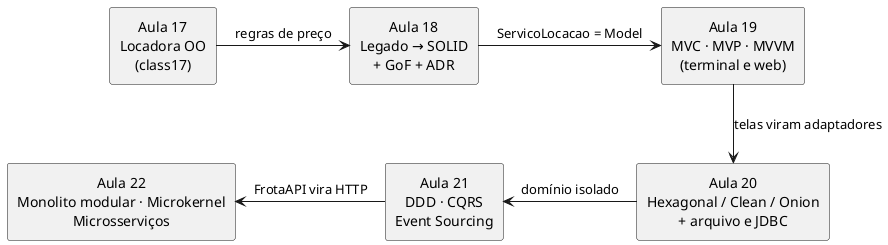

# Workspace UA5 (versão Java) — Projeto e Arquitetura de Software (Aulas 18-22)  

**Projeto e Engenharia de Software** · Prof. Giovane Barcelos · [💻 Códigos Fonte](https://github.com/giovanebarcelos/pes-sandbox/tree/main/ua5-workspace-java)  

A **mesma** Locadora de Veículos da [versão Python](../ua5-workspace/), escrita em **Java 17**. O sistema evolui ao longo das cinco aulas da UA5, cada aula tem a sua pasta e o seu tutorial passo a passo. Os tutoriais Java são distribuídos **junto com os slides da aula** (`Aula_XX_Tutorial_*_Java.md` e `.html`). Quando uma aula usa o resultado da anterior, o tutorial diz de onde veio.  



## Tutoriais  

| Aula | Tutorial (junto com os slides) | Parte de | Entrega |  
|---|---|---|---|  
| 18 | Princípios SOLID, Design Patterns e ADR — `Aula_18_Tutorial_SOLID_Padroes_Java` | `aula18/inicio` (código legado criado a partir da Aula 17) | Locadora refatorada + ADR-0001 |  
| 19 | MVC, MVP e MVVM — `Aula_19_Tutorial_MVC_MVP_MVVM_Java` | `aula19/inicio` = solução da Aula 18 | 3 padrões de apresentação + web + ADR-0002 |  
| 20 | Clean, Hexagonal e Onion — `Aula_20_Tutorial_Clean_Hexagonal_Onion_Java` | `aula20/inicio` = solução da Aula 19 | Hexágono + arquivo/JDBC + teste de arquitetura + ADR-0003 |  
| 21 | DDD, CQRS e Event Sourcing — `Aula_21_Tutorial_DDD_CQRS_EventSourcing_Java` | `aula21/inicio` = solução da Aula 20 | 2 bounded contexts + eventos + projeções + ADR-0004 |  
| 22 | Microsserviços e Arquiteturas Distribuídas — `Aula_22_Tutorial_Microsservicos_Java` | `aula22/inicio` = solução da Aula 21 | Monolito modular + plugins + 3 serviços + ADR-0005 |  

## Estrutura  

```
ua5-workspace-java/
├── README.md · AGENTS.md · opencode.json      # orientações para você e para o agente de IA
├── docker-compose.yml                         # ALTERNATIVA (opcional) com Docker
├── ferramentas/
│   ├── Rodar.java      # compila src/ + test/ e roda os testes ou uma classe
│   ├── Preparar.java   # cria aulaXX/meu (sua cópia de trabalho)
│   └── Verificar.java  # confere o JDK e roda os testes de todas as aulas
├── lib/                # (opcional) driver JDBC para a Aula 20 — ver lib/LEIA-ME.md
└── aula18/ … aula22/
    ├── inicio/         # ponto de partida da aula (não edite)
    ├── solucao/        # referência do professor (não edite; compare)
    └── meu/            # SUA versão — criada por ferramentas/Preparar.java (fora do Git)
        ├── src/        # o código (pacote locadora, e servicos na Aula 22)
        ├── test/       # os testes (*Test.java) + test/teste/, o mini-JUnit
        └── docs/       # ADRs e mapas
```

## Como rodar — modo principal (local, sem Docker)  

Só é preciso um **JDK 17 ou superior** (Temurin, OpenJDK, Oracle — tanto faz; precisa ser **JDK**, que traz o `javac`, e não só o JRE). Nada de Maven, Gradle ou download de bibliotecas: o workspace usa apenas o JDK, então funciona em laboratório sem internet.  

```bash
java -version                            # 17 ou superior
git clone https://github.com/giovanebarcelos/pes-sandbox.git
cd pes-sandbox/ua5-workspace-java
java ferramentas/Verificar.java          # roda os testes de todas as aulas (tudo OK)
java ferramentas/Preparar.java 18        # cria aula18/meu a partir de aula18/inicio
cd aula18/meu
java ../../ferramentas/Rodar.java testes
```

Sem Git? No GitHub, use **Code → Download ZIP** e descompacte; o workspace fica em `pes-sandbox-main/ua5-workspace-java`.  

> **Por que `java Arquivo.java` funciona?** Desde o Java 11, o comando `java` compila e executa sozinho um programa de **um arquivo só**. As três ferramentas usam isso. O `Rodar.java`, por sua vez, compila **todos** os arquivos da aula com a API do `javac` e executa o resultado. É um "Maven de bolso", que você pode ler em 5 minutos.  

### Comandos do dia a dia (dentro da pasta da aula)  

| Quero... | Comando |  
|---|---|  
| rodar todos os testes | `java ../../ferramentas/Rodar.java testes` |  
| rodar só uma classe de teste | `java ../../ferramentas/Rodar.java testes Caracterizacao` |  
| executar um programa | `java ../../ferramentas/Rodar.java locadora.Main` |  
| só compilar (ver erros do `javac`) | `java ../../ferramentas/Rodar.java compilar` |  

No Windows, as barras `/` funcionam igual (`java ..\..\ferramentas\Rodar.java testes` também).  

### Variáveis de ambiente  

Alguns programas leem variáveis (porta, adaptador, arquivo). A sintaxe muda de terminal para terminal:  

| Terminal | Exemplo |  
|---|---|  
| Linux/macOS (bash/zsh) | `LOCADORA_REPO=arquivo java ../../ferramentas/Rodar.java locadora.Main` |  
| PowerShell | `$env:LOCADORA_REPO="arquivo"; java ../../ferramentas/Rodar.java locadora.Main` |  
| cmd | `set LOCADORA_REPO=arquivo` e depois o comando |  

### IDE (opcional)  

Abra a pasta da aula (ex.: `aula18/meu`) no IntelliJ IDEA, VS Code (Extension Pack for Java) ou Eclipse e marque `src/` e `test/` como pastas de código-fonte. O pacote `test/teste/` é um **mini-JUnit** com a mesma API do JUnit 5 (`@Test`, `@BeforeEach`, `assertEquals`, `assertThrows`...). Para usar o JUnit de verdade num projeto Maven/Gradle, basta trocar `import teste.*` por `import org.junit.jupiter.api.*`.  

## Como rodar — alternativa com Docker  

Para quem tem Docker e não tem JDK, ou quer conferir no **Java 17** (a versão mínima). Não há *build*: a imagem oficial `eclipse-temurin:17-jdk` enxerga esta pasta.  

```bash
docker compose run --rm verificar                 # testes de todas as aulas
docker compose run --rm aula20                    # testes da Aula 20 (pasta solucao)
PASTA=meu docker compose run --rm aula20          # testes da SUA versão (Linux/macOS)
docker compose up aula19-web                      # http://localhost:8019
docker compose --profile aula22 up                # os 3 microsserviços da Aula 22
```

No PowerShell, troque `PASTA=meu docker compose ...` por `$env:PASTA="meu"; docker compose ...`.  

## Diferenças em relação à versão Python  

As regras, os valores, os nomes de classes e o roteiro das aulas são os **mesmos**. O que muda é o que o Java oferece (ou não) sem bibliotecas externas:  

| Assunto | Python | Java |  
|---|---|---|  
| Testes | `unittest` | mini-JUnit em `test/teste/` (API do JUnit 5) |  
| Persistência do legado (Aula 18) | `frota.json` | `frota.csv` (o JDK não traz JSON) |  
| Banco da Aula 20 | SQLite (vem com o Python) | **arquivo CSV** sempre + **JDBC** opcional (H2 ou SQLite em `lib/`) |  
| Teste de arquitetura | `ast` lê os imports | lê as linhas `import` dos `.java` (no mercado: ArchUnit) |  
| Eventos (Aula 21) | `dataclass` + decorador `@evento` | `record` + `RegistroEventos.registrar(...)` |  
| JSON (Aulas 21-22) | módulo `json` | `locadora.infra.Json` (mini-JSON; no mercado: Jackson/Gson) |  
| Web e microsserviços | `http.server` + `urllib` | `com.sun.net.httpserver` + `java.net.http.HttpClient` |  
| Plugins (Aula 22) | `importlib` varre a pasta | `java.util.ServiceLoader` + `META-INF/services` |  
| Erros "compatíveis com o legado" | herança múltipla (`KeyError`) | herda de `NoSuchElementException` / `IllegalStateException` |  
| Valores em reais | `f"{v:.2f}"` | `String.format(Locale.ROOT, "%.2f", v)` — sem `Locale.ROOT`, um PC em pt-BR escreveria `660,00` |  

**O contrato HTTP da Aula 22 é idêntico nas duas versões:** dá para rodar a Frota em Python e as Locações em Java (ou o contrário) e eles conversam normalmente.  

## Agente de IA  

Cada tutorial termina com uma seção **🤖 Com o Agente** (prompts por passo, o que validar e erros típicos do agente naquele assunto). O setup é o da **Aula 01B**: `opencode` aberto **nesta pasta** (`ua5-workspace-java/`), modelo gratuito via OpenRouter e skills em `.agents/skills/`. O `AGENTS.md` e o `opencode.json` daqui já dizem ao agente como o workspace funciona, inclusive que **não** pode trazer Maven, Spring ou Lombok.  

**Política (Aula 01B, Slide 32):** primeiro à mão, depois o agente.  
