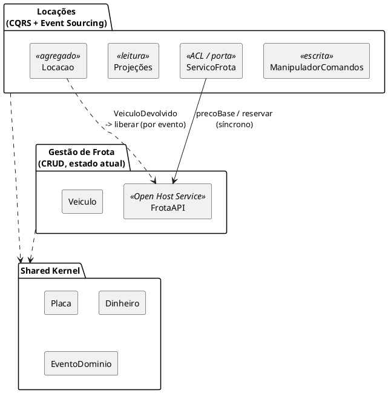

# Mapa de Contextos — Locadora

| Relação | Tipo (DDD) | Por quê |
|---|---|---|
| Locações → Frota | **Cliente/Fornecedor** com **Camada Anticorrupção** (`ServicoFrota`) | Locações precisa de preço e disponibilidade, mas não quer depender das classes internas da frota |
| Frota → mundo | **Open Host Service** (`FrotaAPI`) | Uma API pública estável, que vira HTTP na Aula 22 |
| Ambos | **Shared Kernel** (`compartilhado/`) | `Placa`, `Dinheiro` e a base de eventos são combinados pelos dois times — mantenha pequeno |
