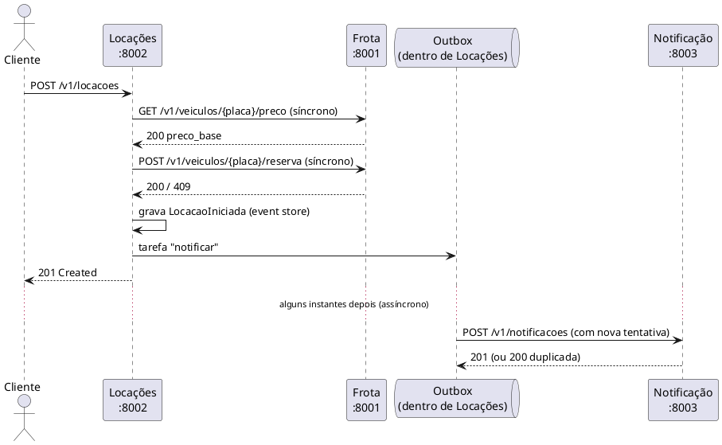

# Comunicação entre os serviços (versão microsserviços)

| Interação | Estilo | Por quê | O que acontece se o outro lado cair |
|---|---|---|---|
| Locações → Frota (preço, reserva) | **Síncrono** (HTTP/JSON) | Sem a resposta não dá para fechar a locação | Locações responde **503** — falha visível, nada é gravado |
| Locações → Frota (liberar na devolução) | **Assíncrono** (outbox) | A devolução já aconteceu; liberar pode esperar | Fica pendente em `GET /v1/outbox` e é feito quando a Frota volta |
| Locações → Notificação | **Assíncrono** (outbox) | Aviso ao cliente não é crítico | Locação conclui normalmente; o aviso chega depois |

**Contratos versionados:** todas as rotas começam com `/v1/`. Mudança incompatível = nova rota `/v2/...`, mantendo a `/v1` enquanto houver consumidor.
