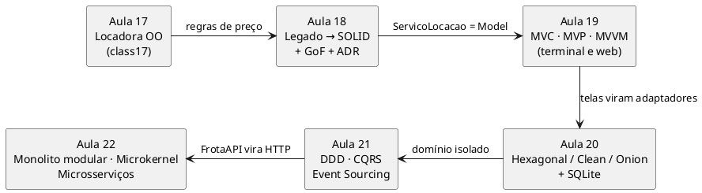

# Workspace UA5 — Projeto e Arquitetura de Software (Aulas 18-22)  

**Projeto e Engenharia de Software** · Prof. Giovane Barcelos · [💻 Códigos Fonte](https://github.com/giovanebarcelos/pes-sandbox/tree/main/ua5-workspace)  

Um único sistema, a **Locadora de Veículos da Aula 17**, evolui ao longo das cinco aulas da UA5. Cada aula tem o seu tutorial passo a passo e a sua própria pasta. Quando uma aula usa o resultado da anterior, o tutorial diz de onde veio.  



## Tutoriais  

| Aula | Tutorial | Parte de | Entrega |  
|---|---|---|---|  
| 18 | [Princípios SOLID, Design Patterns e ADR](tutoriais/Tutorial_Aula18_SOLID_Padroes.md) | `aula18/inicio` (código legado criado a partir da Aula 17) | Locadora refatorada + ADR-0001 |  
| 19 | [MVC, MVP e MVVM](tutoriais/Tutorial_Aula19_MVC_MVP_MVVM.md) | `aula19/inicio` = solução da Aula 18 | 3 padrões de apresentação + web + ADR-0002 |  
| 20 | [Clean, Hexagonal e Onion](tutoriais/Tutorial_Aula20_Clean_Hexagonal_Onion.md) | `aula20/inicio` = solução da Aula 19 | Hexágono + SQLite + teste de arquitetura + ADR-0003 |  
| 21 | [DDD, CQRS e Event Sourcing](tutoriais/Tutorial_Aula21_DDD_CQRS_EventSourcing.md) | `aula21/inicio` = solução da Aula 20 | 2 bounded contexts + eventos + projeções + ADR-0004 |  
| 22 | [Microsserviços e Arquiteturas Distribuídas](tutoriais/Tutorial_Aula22_Microsservicos.md) | `aula22/inicio` = solução da Aula 21 | Monolito modular + plugins + 3 serviços + ADR-0005 |  

## Estrutura  

```
ua5-workspace/
├── README.md · AGENTS.md · opencode.json      # orientações para você e para o agente de IA
├── docker-compose.yml                         # ALTERNATIVA (opcional) com Docker
├── ferramentas/
│   ├── preparar.py     # cria aulaXX/meu (sua cópia de trabalho)
│   └── verificar.py    # confere o Python e roda os testes
├── tutoriais/          # um tutorial por aula
└── aula18/ … aula22/
    ├── inicio/         # ponto de partida da aula (não edite)
    ├── solucao/        # referência do professor (não edite; compare)
    └── meu/            # SUA versão — criada por ferramentas/preparar.py (fora do Git)
```

## Como rodar — modo principal (local, sem Docker)  

Só é preciso **Python 3.10 ou superior**. Nada de `pip install`: o workspace usa apenas a biblioteca padrão (`unittest`, `sqlite3`, `http.server`, `json`), então funciona em laboratório sem internet.  

> **Windows:** use `python` (ou `py`). **Linux/macOS:** use `python3` onde os tutoriais escrevem `python`.  

```bash
python --version                         # 3.10+
git clone https://github.com/giovanebarcelos/pes-sandbox.git
cd pes-sandbox/ua5-workspace
python ferramentas/verificar.py          # roda os testes de todas as aulas (tudo OK)
python ferramentas/preparar.py 18        # cria aula18/meu a partir de aula18/inicio
cd aula18/meu
python -m unittest -v
```

Sem Git? No GitHub, use **Code → Download ZIP** e descompacte; o workspace fica em `pes-sandbox-main/ua5-workspace`.  

## Como rodar — alternativa com Docker  

Para quem tem Docker e não tem Python, ou quer conferir em ambiente limpo. Não há *build*: a imagem oficial `python:3.12-slim` enxerga esta pasta.  

```bash
docker compose run --rm verificar                 # testes de todas as aulas
docker compose run --rm aula20                    # testes da Aula 20 (pasta solucao)
PASTA=meu docker compose run --rm aula20          # testes da SUA versão (Linux/macOS)
docker compose up aula19-web                      # http://localhost:8019
docker compose --profile aula22 up                # os 3 microsserviços da Aula 22
```

No PowerShell, troque `PASTA=meu docker compose ...` por `$env:PASTA="meu"; docker compose ...`.  

## Agente de IA  

Cada tutorial termina com uma seção **🤖 Com o Agente** (prompts por passo, o que validar e erros típicos do agente naquele assunto). O setup é o da **Aula 01B**: `opencode` aberto **nesta pasta** (`ua5-workspace/`), modelo gratuito via OpenRouter e skills em `.agents/skills/`. O `AGENTS.md` e o `opencode.json` daqui já dizem ao agente como o workspace funciona.  

**Política (Aula 01B, Slide 32):** primeiro à mão, depois o agente.  
