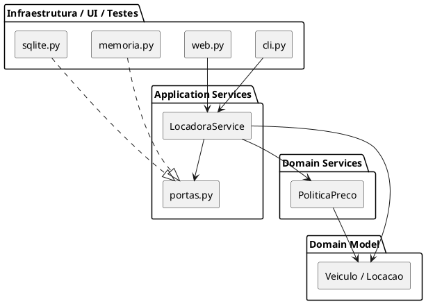

# A mesma solução vista como Onion Architecture

Atividade do Slide 33, item 4: onde cada parte da Locadora ficaria na cebola de Jeffrey Palermo.

| Anel da Onion (de dentro para fora) | O que vai nele | Onde está no nosso código |
|---|---|---|
| **Domain Model** (núcleo) | `Veiculo`, `Carro`, `Moto`, `Caminhao`, `Locacao`, erros de negócio | `locadora/dominio/veiculos.py`, `locacao.py`, `erros.py` |
| **Domain Services** | Regras que não pertencem a uma entidade só: `PoliticaPreco`, `DescontoSemanal`, fábrica de veículos | `locadora/dominio/precos.py`, `fabrica.py` |
| **Application Services** | Casos de uso (`alugar`, `devolver`, `cotar`) + **interfaces de repositório** | `locadora/aplicacao/servico.py`, `portas.py` |
| **Infrastructure / UI / Tests** (anel externo) | SQLite, memória, console, web, testes | `locadora/adaptadores/**`, `locadora/config.py`, `tests/` |

**Diferença principal em relação ao hexágono:** na Onion as interfaces de repositório costumam ficar no anel de *Domain Services* (mais perto do centro). Aqui elas estão em `aplicacao/portas.py`. Nos dois casos a regra é a mesma: **toda dependência aponta para dentro**.

