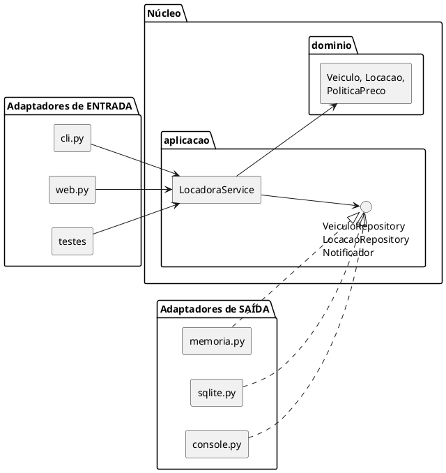

# Tutorial — Aula 20: Clean Architecture, Hexagonal e Onion  

**Projeto e Engenharia de Software** · UA5 — Projeto e Arquitetura de Software · Prof. Giovane Barcelos  
**Slides:** `Aula_20_Clean_Hexagonal_Onion` · **Duração estimada:** 2h30 em sala + extraclasse · **Workspace:** [`ua5-workspace/`](https://github.com/giovanebarcelos/pes-sandbox/tree/main/ua5-workspace)  

## O que você vai construir  

Você vai reorganizar a Locadora em uma **Arquitetura Hexagonal (Ports & Adapters)**: um núcleo (`dominio/` + `aplicacao/`) que não importa banco, rede nem tela, e adaptadores na borda (terminal e web na entrada; memória, **SQLite real** e console na saída). No fim, um **teste de arquitetura** falha sozinho se alguém quebrar a Regra de Dependência, e o mesmo roteiro roda em memória e em SQLite **sem mudar uma linha do `LocadoraService`**.  



## De onde vêm os dados desta aula  

| O que | Origem |  
|---|---|  
| Domínio (`Veiculo`, `Carro`, `Moto`, `Caminhao`, `PoliticaPreco`, fábrica, erros) | **Aula 18** — via `aula20/inicio` (= `aula19/solucao`) |  
| `ServicoLocacao` → renomeado para `LocadoraService` (nome usado nos slides) | **Aula 18** |  
| Terminal MVC e página web MVC → viram **adaptadores de entrada** | **Aula 19** — `locadora/apresentacao/mvc_console.py` e `web_mvc.py` |  
| Porta `VeiculoRepository` e adaptador em memória | Ideia de `repository/class20/python/PES2001-Hexagonal.py` (slides 12-14) |  
| **O que sai daqui** | O núcleo isolado é o ponto de partida dos bounded contexts da **Aula 21** |  

## Mapa do tutorial  

| Passo | Assunto | Slides |  
|---|---|---|  
| 0 | Preparar o ambiente | — |  
| 1 | Diagnóstico: para onde apontam os imports? | 5, 8 |  
| 2 | Criar a estrutura de pastas | 24-28 |  
| 3 | Mover o domínio para o centro | 6-8 |  
| 4 | Definir as portas | 10-11 |  
| 5 | O caso de uso depende só das portas | 11-12 |  
| 6 | Adaptadores de saída: memória e SQLite | 12-14 |  
| 7 | A raiz de composição | 13 |  
| 8 | Adaptadores de entrada: terminal e web | 10-11 |  
| 9 | Teste de contrato e troca de adaptador | 14, 33 |  
| 10 | A Regra de Dependência vira teste | 8, 23, 38 |  
| 11 | A mesma solução vista como Onion | 15-19, 33 |  
| 12 | ADR + checklist de autoavaliação | 36-38 |  
| 🤖 | Com o Agente | 40 |  

---  

## Passo 0 — Preparar o ambiente  

### Opção A (principal): local  

Na pasta `ua5-workspace/`:  

```bash
python ferramentas/verificar.py 20
python ferramentas/preparar.py 20            # ou: --da-minha (parte da sua aula19/meu)
cd aula20/meu
python -m unittest -v
```

✅ **Confira:** `Ran 34 tests ... OK`, que são os testes das Aulas 18 e 19.  

> **Linux/macOS:** `python3` no lugar de `python`.  

### Opção B (alternativa): Docker  

```bash
docker compose run --rm aula20                # testes
docker compose up aula20-web                  # web com SQLite em http://localhost:8020
```

Sua versão: `PASTA=meu docker compose ...` (Linux/macOS) ou `$env:PASTA="meu"; docker compose ...` (PowerShell).  

---  

## Passo 1 — Diagnóstico: para onde apontam os imports?  

A **Regra de Dependência** (Slide 8): o código-fonte só pode depender **para dentro**, na direção do domínio. Liste os imports do projeto:  

```bash
# Linux/macOS
grep -rn "^from\|^import" locadora --include=*.py
# Windows (PowerShell)
Select-String -Path locadora\*.py,locadora\apresentacao\*.py -Pattern "^from|^import"
```

Responda:  

1. `servico.py` importa algum detalhe de infraestrutura? E `repositorio.py`?  
2. Quem decide **qual** repositório usar? Em quantos lugares essa decisão aparece (`main.py`, `montagem.py`...)?  
3. Se amanhã trocarmos JSON por um banco, quais arquivos mudam?  

<details>  
<summary>Comentário</summary>  

O `ServicoLocacao` já recebe o repositório por injeção (DIP, Aula 18), um ótimo começo. Mas a **interface** `RepositorioVeiculos` mora em `repositorio.py`, **junto** com a implementação JSON (`import json`). Quem importa a interface carrega a infraestrutura junto. E a escolha do adaptador está espalhada em `main.py` e em `apresentacao/montagem.py`. Pasta e arquivo ainda não refletem as camadas.  

</details>  

---  

## Passo 2 — Criar a estrutura de pastas  

Vamos organizar **por camada** (Slide 25), no vocabulário do hexágono. O comando funciona em qualquer sistema:  

```bash
python -c "import os; [os.makedirs(p, exist_ok=True) or open(os.path.join(p,'__init__.py'),'a').close() for p in ['locadora/dominio','locadora/aplicacao','locadora/adaptadores','locadora/adaptadores/entrada','locadora/adaptadores/saida']]"
```

Estrutura-alvo:  

```
locadora/
├── dominio/          # NÚCLEO: regras puras (sem banco, rede, tela)
│   ├── veiculos.py · precos.py · fabrica.py · erros.py · locacao.py
├── aplicacao/        # casos de uso + PORTAS
│   ├── portas.py     # VeiculoRepository, LocacaoRepository, Notificador
│   └── servico.py    # LocadoraService
├── adaptadores/
│   ├── entrada/      # cli.py, web.py      (quem CHAMA o núcleo)
│   └── saida/        # memoria.py, sqlite.py, console.py   (quem o núcleo CHAMA via porta)
├── config.py         # raiz de composição: liga adaptadores ao núcleo
└── main.py
```

> ⚠️ **Pasta não é camada** (Slide 23): mover arquivos não isola nada se os imports continuarem errados. O Passo 10 transforma essa regra em teste.  

---  

## Passo 3 — Mover o domínio para o centro  

Mova (recorte e cole; o conteúdo não muda) `veiculos.py`, `precos.py`, `fabrica.py` e `erros.py` para `locadora/dominio/`. Os imports internos deles são relativos (`from .veiculos import ...`), então continuam válidos.  

A entidade `Locacao` estava dentro de `servico.py`. Ela é **domínio**, então ganha arquivo próprio em `locadora/dominio/locacao.py`:  

```python
from dataclasses import dataclass


@dataclass(frozen=True)
class Locacao:
    placa: str
    cliente: str
    dias: int
    valor: float
```

✅ **Confira:** nenhum arquivo de `dominio/` tem `import json`, `sqlite3`, `http`, `print(` ou `input(`.  

---  

## Passo 4 — Definir as portas  

**Atividade do Slide 33, item 1.** Uma porta é uma interface que o **núcleo define** na língua do domínio, nunca na de SQL ou HTTP. Crie `locadora/aplicacao/portas.py`:  

```python
from abc import ABC, abstractmethod


class VeiculoRepository(ABC):
    @abstractmethod
    def salvar(self, veiculo): ...

    @abstractmethod
    def buscar_por_placa(self, placa):
        """Devolve Veiculo ou None."""

    @abstractmethod
    def listar(self): ...


class LocacaoRepository(ABC):
    @abstractmethod
    def adicionar(self, locacao): ...

    @abstractmethod
    def listar(self): ...


class Notificador(ABC):
    @abstractmethod
    def notificar(self, destino, mensagem): ...
```

> 💡 **Novidade:** as locações também ganham uma porta (`LocacaoRepository`). Na Aula 18 elas ficavam numa lista dentro do serviço, e por isso o faturamento sumia ao reiniciar. Agora vão para o banco junto com os veículos.  

---  

## Passo 5 — O caso de uso depende só das portas  

Mova `servico.py` para `locadora/aplicacao/servico.py` e faça três ajustes:  

1. Renomeie a classe para `LocadoraService` (nome dos slides).  
2. Construtor: `__init__(self, veiculos, locacoes, notificador, politica=None)`.  
3. Troque `self._locacoes.append(...)` por `self._locacoes.adicionar(...)`, `self._repo.buscar(...)` por `self._veiculos.buscar_por_placa(...)`, e use `self._locacoes.listar()` no faturamento.  

Os imports ficam assim. Só domínio, nada de adaptador:  

```python
from ..dominio.erros import VeiculoIndisponivel, VeiculoNaoEncontrado
from ..dominio.locacao import Locacao
from ..dominio.precos import SemDesconto
```

Acrescente também `listar_disponiveis()`, que filtra `listar()` pelos veículos disponíveis. Compare o resultado com `aula20/solucao/locadora/aplicacao/servico.py`.  

---  

## Passo 6 — Adaptadores de saída: memória e SQLite  

**Atividade do Slide 33, item 2.** Dois adaptadores para a **mesma** porta.  

### 6.1 Memória (para testes)  

`locadora/adaptadores/saida/memoria.py` com `VeiculoMemoriaRepository`, `LocacaoMemoriaRepository` e `NotificadorMemoria`. Cada classe **herda da porta**:  

```python
from ...aplicacao.portas import LocacaoRepository, Notificador, VeiculoRepository


class VeiculoMemoriaRepository(VeiculoRepository):
    def __init__(self):
        self._dados = {}

    def salvar(self, veiculo):
        self._dados[veiculo.placa] = veiculo

    def buscar_por_placa(self, placa):
        return self._dados.get(placa)

    def listar(self):
        return list(self._dados.values())

# LocacaoMemoriaRepository e NotificadorMemoria: escreva seguindo o mesmo modelo
```

E `adaptadores/saida/console.py` com o `NotificadorConsole` (o `print("[SMTP] ...")` da Aula 18).  

### 6.2 SQLite (de verdade)  

O slide pede um repositório SQL "simulado com prints". Aqui ele é **real**: o `sqlite3` vem com o Python, sem instalar nada. Copie `aula20/solucao/locadora/adaptadores/saida/sqlite.py` e estude:  

- `BancoSqlite` cria as tabelas `veiculos` e `locacoes` e guarda **uma** conexão com uma trava (`threading.Lock`), porque a web atende requisições em várias *threads*.  
- `VeiculoSQLRepository.salvar` usa `INSERT ... ON CONFLICT(placa) DO UPDATE`: inserir ou atualizar em um comando só.  
- `_para_veiculo` usa a **fábrica do domínio** (`criar_veiculo`) para transformar uma linha da tabela de volta em `Carro`/`Moto`/`Caminhao`.  
- Os parâmetros vão como `?`, **nunca** com f-string dentro do SQL (que abriria brecha para *SQL injection*).  

✅ **Confira:** `sqlite.py` é o **único** arquivo do projeto que contém SQL.  

---  

## Passo 7 — A raiz de composição  

Um único módulo conhece **todos** os adaptadores e decide qual usar. Copie `aula20/solucao/locadora/config.py` e leia a função `montar()`:  

```python
def montar(repo=None, caminho_db=None, silencioso=False, semear=True):
    repo = repo or os.environ.get("LOCADORA_REPO", "memoria")
    if repo == "sqlite":
        banco = BancoSqlite(caminho_db or os.environ.get("LOCADORA_DB", "dados/locadora.db"))
        veiculos, locacoes = VeiculoSQLRepository(banco), LocacaoSQLRepository(banco)
    elif repo == "memoria":
        veiculos, locacoes = VeiculoMemoriaRepository(), LocacaoMemoriaRepository()
    ...
```

A escolha do adaptador sai do código e vai para uma **variável de ambiente**. Copie também `main.py`, que roda o **mesmo roteiro** com os dois adaptadores:  

```bash
python -m locadora.main
```

✅ **Saída esperada:**  

```
--- Adaptador: memória ---
  Disponíveis: ['DEF-5678', 'CAM-0001']
  Faturamento: R$ 1164.00
--- Adaptador: SQLite (:memory:) ---
  Disponíveis: ['DEF-5678', 'CAM-0001']
  Faturamento: R$ 1164.00
LocadoraService não mudou nenhuma linha entre as duas execuções.
```

---  

## Passo 8 — Adaptadores de entrada: terminal e web  

O MVC da Aula 19 continua igual por dentro, só muda de lugar e de dependência:  

1. Mova `apresentacao/mvc_console.py` para `adaptadores/entrada/cli.py` e `apresentacao/web_mvc.py` para `adaptadores/entrada/web.py`.  
2. Em ambos, troque:  
   - `from ..erros import LocadoraErro` → `from ...dominio.erros import LocadoraErro`  
   - `from .montagem import servico_exemplo` → `from ...config import montar`  
   - `servico_exemplo()` → `montar()`  
3. Na web, mude a porta padrão para `8020`.  
4. Apague a pasta `apresentacao/` (MVP e MVVM ficam como referência em `aula19/solucao`) e os antigos `repositorio.py`, `notificacao.py` e `relatorio.py` da raiz de `locadora/`, cujo conteúdo agora mora nos adaptadores.  

Rode a web **com SQLite**:  

```bash
# Linux/macOS
LOCADORA_REPO=sqlite python -m locadora.adaptadores.entrada.web
# Windows (PowerShell)
$env:LOCADORA_REPO="sqlite"; python -m locadora.adaptadores.entrada.web
```

Abra **http://localhost:8020**, alugue um veículo, **pare o servidor (Ctrl+C) e suba de novo**. O veículo continua alugado, porque está em `dados/locadora.db`. Com `LOCADORA_REPO=memoria`, o mesmo teste perde os dados ao reiniciar.  

---  

## Passo 9 — Teste de contrato e troca de adaptador  

**Atividade do Slide 33, item 3.** Apague os testes antigos de `tests/` (eles importam módulos que mudaram de lugar) e copie de `aula20/solucao/tests/`:  

| Arquivo | O que prova |  
|---|---|  
| `test_dominio.py` | Regras de preço testadas **sem** serviço, banco ou adaptador |  
| `test_contrato_repositorio.py` | **A mesma bateria** roda contra memória e SQLite. Um adaptador novo (PostgreSQL?) que passe aqui pode substituir os outros: é o LSP aplicado à arquitetura |  
| `test_troca_adaptador.py` | O mesmo roteiro dá o mesmo resultado em memória e em SQLite; o arquivo SQLite sobrevive a um "reinício" |  
| `test_entrada.py` | Terminal e web continuam funcionando sobre o hexágono |  

Veja o truque do contrato:  

```python
class ContratoRepositorio:            # mixin: NÃO herda de TestCase
    def criar(self):
        raise NotImplementedError
    def test_salvar_e_buscar(self): ...

class TestMemoria(ContratoRepositorio, unittest.TestCase):
    def criar(self):
        return VeiculoMemoriaRepository(), LocacaoMemoriaRepository()

class TestSQLite(ContratoRepositorio, unittest.TestCase):
    def criar(self):
        banco = BancoSqlite(":memory:")
        return VeiculoSQLRepository(banco), LocacaoSQLRepository(banco)
```

```bash
python -m unittest -v
```

---  

## Passo 10 — A Regra de Dependência vira teste  

Copie `aula20/solucao/tests/test_arquitetura.py`. Ele **lê o código-fonte** com o módulo `ast` (sem executá-lo) e verifica:  

- `dominio/` não importa `aplicacao`, `adaptadores`, `config`, `sqlite3`, `json`, `http`, `urllib`...  
- `aplicacao/` não importa `adaptadores` nem `config`.  

**Quebre de propósito** para ver o teste trabalhar:  

```bash
python -c "open('locadora/dominio/precos.py','a').write('\nimport sqlite3\n')"
python -m unittest tests.test_arquitetura
```

✅ **Confira:** `FAIL: test_dominio_nao_conhece_ninguem ... (arquivo='precos.py', importa='sqlite3')`. Agora **desfaça**: apague a linha `import sqlite3` do fim de `precos.py` e rode de novo (OK).  

> 💡 Esse teste responde à primeira pergunta do **checklist de autoavaliação** (Slide 38) automaticamente, a cada execução, e não só no dia da entrega.  

---  

## Passo 11 — A mesma solução vista como Onion  

**Atividade do Slide 33, item 4.** Preencha **antes** de olhar `aula20/solucao/docs/onion.md`:  

| Anel da Onion (de dentro para fora) | O que vai nele | Arquivo no nosso código |  
|---|---|---|  
| Domain Model | | |  
| Domain Services | | |  
| Application Services | | |  
| Infraestrutura / UI / Testes | | |  

Depois responda: **qual a diferença real** entre o que fizemos (Hexagonal) e a Onion? E a Clean Architecture? (Slides 18-19)  

**Estrutura de diretórios (Slides 24-30):** a nossa organização é **por camada**. Esboce em texto a mesma Locadora organizada **por feature** (`locacao/`, `frota/`, cada uma com o seu domínio, portas e adaptadores). Qual das duas você usaria na A3, e por quê? Guarde a resposta: a Aula 21 caminha nessa direção.  

---  

## Passo 12 — ADR + checklist de autoavaliação  

Escreva `docs/adr/0003-arquitetura-<sua-escolha>-para-a-locadora.md` (formato da Aula 18, exemplo no Slide 36) escolhendo entre Clean, Hexagonal e Onion **para este contexto**. Compare com `aula20/solucao/docs/adr/0003-arquitetura-hexagonal-para-a-locadora.md`.  

**Checklist do Slide 38:**  

- [ ] O domínio importa alguma biblioteca de framework, ORM ou web? → `test_arquitetura.py` responde  
- [ ] Existe pelo menos uma porta entre o domínio e a infraestrutura? → `aplicacao/portas.py`  
- [ ] Dá para testar as regras sem subir banco ou servidor? → `test_dominio.py`  
- [ ] A direção das dependências no código bate com o diagrama? → compare com o diagrama do início  
- [ ] A escolha foi justificada por escrito em um ADR? → ADR-0003  

### Checklist de entrega  

- [ ] `python -m unittest -v` verde em `aula20/meu`  
- [ ] Web rodando com SQLite e mantendo os dados após reiniciar  
- [ ] Teste de arquitetura falhou quando você quebrou a regra (e voltou a passar)  
- [ ] Tabela Onion + esboço "por feature"  
- [ ] ADR-0003  

---  

## 🤖 Com o Agente  

> **Primeiro à mão, depois o agente** (Aula 01B, Slide 32).  

**Setup:** o da **Aula 01B**, com `opencode` aberto em `ua5-workspace/`. Para só analisar, sem editar arquivos, aperte **Tab** e use o agente **plan**.  

### Prompts por passo  

| Passo | Modo | Prompt |  
|---|---|---|  
| 1 | plan | *"Verifique a Regra de Dependência em aula20/meu/locadora: liste todo import do domínio ou do serviço que aponte para banco, arquivo, framework ou interface."* |  
| 4-6 | build | *"Crie a porta LocacaoRepository em aplicacao/portas.py e um adaptador em memória, e escreva um teste do LocadoraService usando esse adaptador falso. Rode python -m unittest -v."* |  
| 6 | plan | *"Revise aula20/meu/locadora/adaptadores/saida/sqlite.py procurando SQL injection, conexão não fechada e problemas com várias threads."* |  
| 10 | build | *"Escreva um teste com o módulo ast que falhe se locadora/dominio importar sqlite3, json, http ou qualquer coisa de locadora.adaptadores."* |  
| 11 | plan | *"Proponha duas estruturas de diretórios para o projeto da A3 — por camada e por feature (Slides 25-26 da Aula 20) —, com os trade-offs de cada uma."* |  
| 12 | build | *"Use a skill grill-with-docs para me questionar sobre Clean × Hexagonal × Onion no contexto da Locadora e registrar o ADR em aula20/meu/docs/adr/."* |  

### Você valida  

- O teste do domínio roda **sem banco e sem framework**? É a prova de que o domínio está isolado.  
- **Pasta não é camada** (Slide 23): o agente costuma "reorganizar" movendo arquivos e mantendo imports cruzados. Rode o `test_arquitetura.py` depois de qualquer mudança dele.  
- O agente pode propor SQLAlchemy, Flask ou FastAPI. **Recuse**: o `AGENTS.md` proíbe dependências externas, e o ponto da aula é que trocar a tecnologia **não deve** exigir mudar o núcleo.  
- Clean × Hexagonal × Onion vai para o **ADR**: a IA rascunha os prós e contras, **você decide** (Slide 36).  

### Registro  

| Prompt (resumo) | O que o agente acertou | O que errou ou omitiu | O que você corrigiu |  
|---|---|---|---|  
| | | | |  

---  

## Problemas comuns  

| Sintoma | Causa provável | Solução |  
|---|---|---|  
| `ImportError: attempted relative import beyond top-level package` | Número errado de pontos no `from ...` | `dominio/x.py` → `from ..aplicacao`; `adaptadores/saida/x.py` → `from ...aplicacao` |  
| `ModuleNotFoundError: locadora.repositorio` nos testes | Testes antigos da Aula 19 | Substitua-os pelos testes do Passo 9 |  
| `sqlite3.ProgrammingError: ... thread` | Conexão usada por várias threads sem `check_same_thread=False` | Use o `BancoSqlite` da solução (conexão + trava) |  
| Os dados do SQLite "não somem" ao recomeçar o exercício | `dados/locadora.db` continua no disco | Apague a pasta `dados/` |  
| `docker compose up aula20-web` com dados antigos | Volume `dados20` persistente | `docker compose down -v` |  

## Próxima aula  

Na **Aula 21**, o núcleo isolado aqui é **dividido em dois bounded contexts** (Gestão de Frota e Locações). As locações deixam de ser linhas de tabela e passam a ser uma **sequência de eventos** (Event Sourcing), com leituras separadas das escritas (CQRS). O ponto de partida (`aula21/inicio`) é cópia de `aula20/solucao`; para partir do seu código, use `python ferramentas/preparar.py 21 --da-minha`.  
