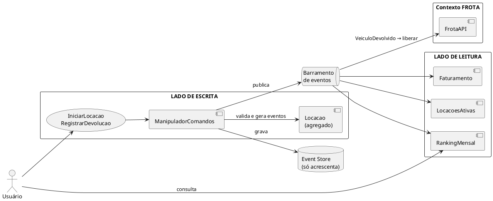

# Tutorial — Aula 21: DDD, CQRS e Event Sourcing  

**Projeto e Engenharia de Software** · UA5 — Projeto e Arquitetura de Software · Prof. Giovane Barcelos  
**Slides:** `Aula_21_DDD_CQRS_EventSourcing` · **Duração estimada:** 2h30 em sala + extraclasse · **Workspace:** [`ua5-workspace/`](https://github.com/giovanebarcelos/pes-sandbox/tree/main/ua5-workspace)  

## O que você vai construir  

A Locadora cresceu: agora tem um time que cuida da **frota** e outro que cuida das **locações**, e a gerência pediu **multa por atraso**, **histórico auditável** e relatórios mensais. Você vai:  

1. escrever a **linguagem ubíqua** (glossário);  
2. separar o sistema em **dois bounded contexts** com uma fronteira verificada por teste;  
3. criar **objetos de valor** (`Placa`, `Dinheiro`) e um **agregado** (`Locacao`) que se reconstrói a partir de **eventos**;  
4. separar **escrita** (comandos) de **leitura** (projeções): CQRS;  
5. fazer os contextos conversarem por **eventos de domínio**.  



## De onde vêm os dados desta aula  

| O que | Origem |  
|---|---|  
| `Veiculo`, `Carro`, `Moto`, `Caminhao`, fábrica | **Aula 18**, isolados no domínio na **Aula 20** (`aula21/inicio` = `aula20/solucao`) |  
| `DescontoSemanal` (Strategy) | **Aula 18**: agora pertence ao contexto de Locações |  
| Portas e adaptadores, teste de arquitetura com `ast` | **Aula 20**: reaproveitados por contexto |  
| Observer (base do barramento de eventos) | **Aula 18** (GoF) e **Aula 19** (`Observavel` do MVVM) |  
| Regra nova: multa por atraso = 1,5 × diária média × dias de atraso | Criada para esta aula (pedido da "gerência") |  
| **O que sai daqui** | A `FrotaAPI` vira um **microsserviço HTTP** na **Aula 22**, e o `ServicoFrota` ganha um adaptador de rede |  

## Mapa do tutorial  

| Passo | Assunto | Slides |  
|---|---|---|  
| 0 | Preparar o ambiente | — |  
| 1 | Linguagem ubíqua: o glossário | 6-7 |  
| 2 | Entidades, objetos de valor e agregados | 10-11, 16 |  
| 3 | Dois bounded contexts | 8-9 |  
| 4 | Objetos de valor: `Placa` e `Dinheiro` | 11 |  
| 5 | Contexto de Frota e a sua API pública | 8, 12 |  
| 6 | Eventos de domínio da locação | 21-22 |  
| 7 | O agregado `Locacao` com Event Sourcing | 22-23 |  
| 8 | Testes "dados / quando / então" | 25 |  
| 9 | Event store e concorrência otimista | 22, 24 |  
| 10 | CQRS, lado de escrita: comandos | 17-18 |  
| 11 | CQRS, lado de leitura: projeções | 18-19 |  
| 12 | Ligando tudo + integração por eventos | 32 |  
| 13 | Reprocessar a história (replay) | 22, 26 |  
| 14 | Fronteiras verificadas por teste | 9 |  
| 15 | ADR: onde **não** usar CQRS/ES | 19, 26-27, 33 |  
| 🤖 | Com o Agente | 34 |  

---  

## Passo 0 — Preparar o ambiente  

### Opção A (principal): local  

Na pasta `ua5-workspace/`:  

```bash
python ferramentas/verificar.py 21
python ferramentas/preparar.py 21            # ou: --da-minha (parte da sua aula20/meu)
cd aula21/meu
python -m unittest -v
```

✅ **Confira:** `Ran 19 tests ... OK`, que são os testes da Aula 20.  

> **Linux/macOS:** `python3` no lugar de `python`.  

### Opção B (alternativa): Docker  

```bash
docker compose run --rm aula21                             # testes
docker compose run --rm aula21 python -m locadora.main     # demonstração
```

Sua versão: `PASTA=meu docker compose ...` (Linux/macOS) ou `$env:PASTA="meu"; docker compose ...` (PowerShell).  

---  

## Passo 1 — Linguagem ubíqua: o glossário  

Antes de qualquer código, **as palavras**. Releia as regras da Locadora (Aulas 17 e 18 e as regras novas acima) e crie `GLOSSARY.md` na raiz de `aula21/meu`:  

| Termo | Contexto | Significado | No código |  
|---|---|---|---|  
| Veículo | ? | | |  
| Locação | ? | | |  
| Diária | ? | | |  
| Devolução | ? | | |  
| Atraso / Multa | ? | | |  

Dica: o **mesmo termo** pode significar coisas diferentes em lugares diferentes. Para a Frota, "veículo" é um bem com placa, modelo e diária. Para Locações, é só "uma placa com um preço". Isso é um sinal de **dois contextos**.  

Compare depois com `aula21/solucao/GLOSSARY.md`.  

---  

## Passo 2 — Entidades, objetos de valor e agregados  

**Atividade do Slide 30, item 1.** Classifique, à mão:  

| Conceito | Entidade, objeto de valor ou agregado? | Por quê |  
|---|---|---|  
| Veículo | | |  
| Placa | | |  
| Valor em reais | | |  
| Locação | | |  
| Período (início + dias previstos) | | |  

<details>  
<summary>Gabarito</summary>  

| Conceito | Tipo | Por quê |  
|---|---|---|  
| Veículo | **Entidade** (raiz do agregado Veículo, na Frota) | Tem identidade (placa) e estado que muda (disponível ou alugado) |  
| Placa | **Objeto de valor** | Definida pelo próprio valor, imutável, validada na criação |  
| Valor em reais | **Objeto de valor** (`Dinheiro`) | Sem identidade; R$ 10 é igual a R$ 10; imutável |  
| Locação | **Entidade e raiz do agregado** (em Locações) | Tem identidade (id) e ciclo de vida (iniciada → devolvida → multada); protege as invariantes |  
| Período | **Objeto de valor** (aqui, campos do evento) | Definido pelos atributos |  

**Invariantes que a raiz `Locacao` protege:** pelo menos 1 dia; não se devolve duas vezes; a devolução não pode ser anterior ao início; atraso gera multa.  

</details>  

---  

## Passo 3 — Dois bounded contexts  

**Atividade do Slide 30, item 2.** A estrutura nova é organizada **por contexto** (feature), cada um com as suas camadas (lembra do Passo 11 da Aula 20?):  

```
locadora/
├── compartilhado/        # Shared Kernel: Placa, Dinheiro, base de eventos (mantenha PEQUENO)
├── frota/                # Contexto GESTÃO DE FROTA — estado atual (CRUD)
│   ├── dominio/          # veiculos.py, fabrica.py, erros.py, eventos.py
│   ├── adaptadores/      # memoria.py
│   └── api.py            # ÚNICA porta de entrada pública do contexto
├── locacoes/             # Contexto LOCAÇÕES — CQRS + Event Sourcing
│   ├── dominio/          # eventos.py, locacao.py (agregado), precos.py, erros.py, portas.py
│   ├── aplicacao/        # comandos.py (escrita), consultas.py (leitura)
│   └── adaptadores/      # event_store.py, frota_local.py
├── config.py
└── main.py
```

Crie as pastas (qualquer sistema):  

```bash
python -c "import os; [os.makedirs(p, exist_ok=True) or open(os.path.join(p,'__init__.py'),'a').close() for p in ['locadora/compartilhado','locadora/frota','locadora/frota/dominio','locadora/frota/adaptadores','locadora/locacoes','locadora/locacoes/dominio','locadora/locacoes/aplicacao','locadora/locacoes/adaptadores']]"
```

Leia o **mapa de contextos** em `aula21/solucao/docs/contextos.md`. As relações são: **Cliente/Fornecedor** com **Camada Anticorrupção** (Locações → Frota), **Open Host Service** (`FrotaAPI`) e **Shared Kernel** (`compartilhado/`).  

---  

## Passo 4 — Objetos de valor: `Placa` e `Dinheiro`  

Crie `locadora/compartilhado/valor.py`:  

```python
import re
from dataclasses import dataclass

_PLACA = re.compile(r"^[A-Z]{3}-?[0-9][A-Z0-9][0-9]{2}$")


@dataclass(frozen=True)
class Placa:
    valor: str

    def __post_init__(self):
        normalizada = self.valor.strip().upper()
        if not _PLACA.match(normalizada):
            raise ValueError(f"Placa inválida: {self.valor!r}")
        object.__setattr__(self, "valor", normalizada)

    def __str__(self):
        return self.valor


@dataclass(frozen=True)
class Dinheiro:
    centavos: int

    @classmethod
    def de_reais(cls, reais):
        return cls(int(round(float(reais) * 100)))

    def __add__(self, outro):
        return Dinheiro(self.centavos + outro.centavos)

    def vezes(self, fator):
        return Dinheiro(int(round(self.centavos * fator)))

    @property
    def reais(self):
        return self.centavos / 100

    def __str__(self):
        return f"R$ {self.reais:.2f}"
```

✅ **Confira** (lembra do `396.00000000000006` da Aula 18?):  

```bash
python -c "from locadora.compartilhado.valor import Dinheiro as D, Placa as P; print(D.de_reais(0.1)+D.de_reais(0.2)==D.de_reais(0.3), P(' abc-1234 '), P('bra2e19'))"
```

Saída: `True ABC-1234 BRA2E19`. `frozen=True` garante a imutabilidade, e a igualdade por atributos vem do `@dataclass`. Para os testes, copie `aula21/solucao/tests/test_valor.py`.  

---  

## Passo 5 — Contexto de Frota e a sua API pública  

1. **Mova** `dominio/veiculos.py` e `dominio/fabrica.py` (da Aula 20) para `frota/dominio/`.  
2. Crie `frota/dominio/erros.py` (`FrotaErro`, `VeiculoNaoEncontrado`, `VeiculoIndisponivel`), `frota/dominio/eventos.py` (`VeiculoCadastrado`) e `frota/adaptadores/memoria.py` (o repositório em memória da Aula 20). Copie-os da solução.  
3. Crie `frota/api.py`, a **única** porta pública do contexto (*Open Host Service*). Ela devolve **dados simples** (dict, float), nunca as classes internas:  

```python
from ..compartilhado.valor import Placa
from .dominio.erros import VeiculoIndisponivel, VeiculoNaoEncontrado
from .dominio.eventos import VeiculoCadastrado
from .dominio.fabrica import criar_veiculo


class FrotaAPI:
    def __init__(self, repositorio, barramento=None):
        self._repo = repositorio
        self._barramento = barramento

    def cadastrar(self, tipo, placa, modelo, diaria):
        placa = str(Placa(placa))
        self._repo.salvar(criar_veiculo(tipo, placa, modelo, diaria))
        if self._barramento:
            self._barramento.publicar([VeiculoCadastrado(placa, tipo, modelo, float(diaria))])

    def listar(self):
        return [{"placa": v.placa, "tipo": v.tipo, "modelo": v.modelo,
                 "diaria": v.valor_diaria, "disponivel": v.disponivel}
                for v in self._repo.listar()]

    def preco_base(self, placa, dias):
        return round(self._obter(placa).preco_base(dias), 2)

    def reservar(self, placa):
        v = self._obter(placa)
        if not v.disponivel:
            raise VeiculoIndisponivel(f"Veículo {placa} já está alugado")
        v.marcar_alugado()
        self._repo.salvar(v)

    def liberar(self, placa):
        v = self._obter(placa)
        v.marcar_disponivel()
        self._repo.salvar(v)

    def _obter(self, placa):
        v = self._repo.buscar_por_placa(str(Placa(placa)))
        if v is None:
            raise VeiculoNaoEncontrado(f"Veículo {placa} não encontrado")
        return v
```

> 💡 Por que devolver `dict` e não `Veiculo`? Se Locações recebesse objetos `Veiculo`, qualquer mudança na classe da Frota quebraria Locações. Com dados simples, a Frota muda por dentro à vontade. Na Aula 22, esse mesmo `dict` vira **JSON** pela rede.  

---  

## Passo 6 — Eventos de domínio da locação  

**Atividade do Slide 30, item 3.** Modele "registrar devolução" como uma **sequência de eventos**. Antes do código, escreva no papel: *uma locação de 5 dias que começou em 02/11 e foi devolvida em 09/11 gera quais eventos, com quais dados?*  

1. Copie `aula21/solucao/locadora/compartilhado/eventos.py`. Ele traz a base `EventoDominio`, o decorador `@evento` (registra a classe para o evento poder ser lido de volta do disco) e o `BarramentoEventos` (Observer).  

2. Crie `locadora/locacoes/dominio/eventos.py`:  

```python
from dataclasses import dataclass

from ...compartilhado.eventos import EventoDominio, evento


@evento
@dataclass(frozen=True)
class LocacaoIniciada(EventoDominio):
    placa: str
    cliente: str
    data_inicio: str              # ISO: "2026-11-02"
    dias_previstos: int
    valor_previsto_centavos: int


@evento
@dataclass(frozen=True)
class VeiculoDevolvido(EventoDominio):
    placa: str
    data_devolucao: str
    dias_utilizados: int


@evento
@dataclass(frozen=True)
class MultaPorAtrasoAplicada(EventoDominio):
    dias_atraso: int
    valor_centavos: int
```

Regras de bons eventos: nome **no passado** (fato consumado), **imutáveis** e com tipos que viram JSON sem perda (texto ISO para datas, centavos inteiros para dinheiro).  

---  

## Passo 7 — O agregado `Locacao` com Event Sourcing  

As três regras do Event Sourcing (Slides 22-23):  

1. o método de **comando** valida a invariante e **gera eventos**, sem mudar o estado direto;  
2. `_aplicar(evento)` é o **único** lugar que muda o estado;  
3. carregar = aplicar, em ordem, todos os eventos gravados (`reconstituir`).  

Copie também `locacoes/dominio/erros.py` e mova `dominio/precos.py` (da Aula 20) para `locacoes/dominio/precos.py`. Depois crie `locadora/locacoes/dominio/locacao.py`:  

```python
from datetime import date

from ...compartilhado.valor import Dinheiro, Placa
from .erros import DataInvalida, LocacaoJaEncerrada
from .eventos import LocacaoIniciada, MultaPorAtrasoAplicada, VeiculoDevolvido

FATOR_MULTA = 1.5


class Locacao:
    def __init__(self, id_locacao):
        self.id = id_locacao
        self.versao = 0
        self.pendentes = []
        self.placa = None
        self.cliente = None
        self.data_inicio = None
        self.dias_previstos = 0
        self.valor_previsto = Dinheiro(0)
        self.multa = Dinheiro(0)
        self.encerrada = False

    # ---------- comandos ----------
    @classmethod
    def iniciar(cls, id_locacao, placa, cliente, data_inicio, dias_previstos, valor_previsto):
        if dias_previstos < 1:
            raise DataInvalida("A locação precisa de pelo menos 1 dia")
        locacao = cls(id_locacao)
        locacao._registrar(LocacaoIniciada(
            id_locacao, str(Placa(placa)), cliente, data_inicio.isoformat(),
            int(dias_previstos), valor_previsto.centavos))
        return locacao

    def registrar_devolucao(self, data_devolucao):
        if self.encerrada:
            raise LocacaoJaEncerrada(f"Locação {self.id} já foi encerrada")
        if data_devolucao < self.data_inicio:
            raise DataInvalida("Devolução antes do início da locação")
        dias_utilizados = max(1, (data_devolucao - self.data_inicio).days)
        self._registrar(VeiculoDevolvido(self.id, self.placa, data_devolucao.isoformat(),
                                         dias_utilizados))
        atraso = dias_utilizados - self.dias_previstos
        if atraso > 0:
            diaria_media = self.valor_previsto.vezes(1 / self.dias_previstos)
            multa = diaria_media.vezes(FATOR_MULTA * atraso)
            self._registrar(MultaPorAtrasoAplicada(self.id, atraso, multa.centavos))

    @property
    def valor_total(self):
        return self.valor_previsto + self.multa

    # ---------- event sourcing ----------
    @classmethod
    def reconstituir(cls, id_locacao, eventos):
        locacao = cls(id_locacao)
        for e in eventos:
            locacao._aplicar(e)
        return locacao

    def _registrar(self, evento):
        self._aplicar(evento)
        self.pendentes.append(evento)

    def _aplicar(self, e):
        if isinstance(e, LocacaoIniciada):
            self.placa, self.cliente = e.placa, e.cliente
            self.data_inicio = date.fromisoformat(e.data_inicio)
            self.dias_previstos = e.dias_previstos
            self.valor_previsto = Dinheiro(e.valor_previsto_centavos)
        elif isinstance(e, VeiculoDevolvido):
            self.encerrada = True
        elif isinstance(e, MultaPorAtrasoAplicada):
            self.multa = Dinheiro(e.valor_centavos)
        self.versao += 1
```

> 💡 Repare que **nenhuma data "de hoje"** é calculada dentro do domínio: quem chama passa a data. Isso torna os testes determinísticos (o mesmo resultado em qualquer dia).  

---  

## Passo 8 — Testes "dados / quando / então"  

O formato do Slide 25: **dados** estes eventos passados, **quando** este comando, **então** estes eventos novos (ou este erro).  

```python
INICIADA = LocacaoIniciada("L-1", "ABC-1234", "Ana", "2026-11-02", 5, 66000)

def test_devolucao_atrasada_gera_multa(self):
    loc = Locacao.reconstituir("L-1", [INICIADA])                # DADOS
    loc.registrar_devolucao(date(2026, 11, 9))                   # QUANDO (7 dias, 2 de atraso)
    self.assertEqual(loc.pendentes[-1],                          # ENTÃO
                     MultaPorAtrasoAplicada("L-1", 2, 39600))    # 132,00 × 1,5 × 2 = 396,00
```

Escreva **pelo menos 3** testes antes de olhar `aula21/solucao/tests/test_agregado_locacao.py`: devolução no prazo, devolução atrasada e devolução duplicada.  

---  

## Passo 9 — Event store e concorrência otimista  

Copie `locacoes/dominio/portas.py` (portas `ServicoFrota` e `EventStore`) e `locacoes/adaptadores/event_store.py`. São duas implementações:  

- `EventStoreMemoria`: lista de `(id_agregado, evento)`. Em `anexar(id, eventos, versao_esperada)`, se outro processo já gravou eventos depois que você leu o agregado, lança `ConflitoDeConcorrencia`. É a **concorrência otimista**: ninguém trava nada; quem chega atrasado repete.  
- `EventStoreArquivo`: o mesmo, mas cada evento também vira **uma linha JSON** num arquivo `.jsonl`, que só cresce. Esse arquivo é a **fonte da verdade**.  

✅ **Confira:** depois do Passo 12, rode a demo com arquivo e abra `dados/eventos.jsonl` num editor. Cada linha é um fato.  

---  

## Passo 10 — CQRS, lado de escrita: comandos  

**Comando** = intenção ("IniciarLocacao"), que pode ser recusada. **Evento** = fato ("LocacaoIniciada"), que não se discute. Copie `locacoes/aplicacao/comandos.py` e acompanhe o fluxo de `_iniciar`:  

1. pergunta o **preço-base** à Frota (pela porta `ServicoFrota`);  
2. aplica o `DescontoSemanal` e converte para `Dinheiro`;  
3. `Locacao.iniciar(...)` valida as invariantes e gera `LocacaoIniciada`;  
4. **reserva** o veículo na Frota (síncrono: é preciso saber se está livre);  
5. grava os eventos no event store e os **publica** no barramento.  

E o adaptador que liga Locações à Frota **sem importar nada da Frota**, `locacoes/adaptadores/frota_local.py`:  

```python
from ..dominio.portas import ServicoFrota


class FrotaLocal(ServicoFrota):
    def __init__(self, frota_api):          # a FrotaAPI chega por injeção
        self._api = frota_api

    def preco_base(self, placa, dias):
        return self._api.preco_base(placa, dias)

    def reservar(self, placa):
        self._api.reservar(placa)

    def liberar(self, placa):
        self._api.liberar(placa)
```

Essa é a **Camada Anticorrupção**: Locações fala com a Frota com as suas próprias palavras. Na Aula 22 nasce um irmão, `FrotaHttp`, com a mesma porta.  

---  

## Passo 11 — CQRS, lado de leitura: projeções  

**Bônus do Slide 30, item 4: "veículos mais alugados no mês".** Responder isso lendo agregados um a um seria lento e complicado. No CQRS, mantemos um **modelo de leitura** pronto, atualizado a cada evento.  

Copie `locacoes/aplicacao/consultas.py`. A base é pequena:  

```python
class Projecao:
    def tratar(self, evento):
        metodo = getattr(self, f"ao_{type(evento).__name__}", None)
        if metodo:
            metodo(evento)

    def reconstruir(self, eventos):
        self.__init__()
        for e in eventos:
            self.tratar(e)


class RankingMensal(Projecao):
    def __init__(self):
        self.por_mes = defaultdict(Counter)

    def ao_LocacaoIniciada(self, e):
        self.por_mes[e.data_inicio[:7]][e.placa] += 1

    def mais_alugados(self, mes, limite=3):
        return self.por_mes[mes].most_common(limite)
```

**Exercício:** crie uma projeção nova, `MultasPorCliente`, que responda *"quanto cada cliente já pagou de multa?"*. Dica: `MultaPorAtrasoAplicada` não traz o cliente, então a projeção precisa lembrar o cliente de cada `id_agregado` quando vê `LocacaoIniciada` (como `Faturamento` faz com o mês).  

---  

## Passo 12 — Ligando tudo + integração por eventos  

Copie `config.py` e `main.py` da solução e apague as pastas antigas `dominio/`, `aplicacao/` e `adaptadores/` da raiz de `locadora/` (o conteúdo agora mora nos contextos). Repare nesta linha de `config.py`:  

```python
barramento.inscrever(VeiculoDevolvido, lambda e: servico_frota.liberar(e.placa))
```

O comando de devolução **não chama** a Frota: ele só publica `VeiculoDevolvido`, e uma **política** reage liberando o veículo. Os contextos ficam desacoplados (Slide 32: "eventos de domínio para comunicação").  

```bash
python -m locadora.main
```

✅ **Confira** as últimas linhas:  

```
  Mais alugados 2026-11: [('ABC-1234', 2), ('XYZ-9012', 1)]
  Faturamento 2026-11: R$ 1824.00
  Frota: [('ABC-1234', True), ('DEF-5678', True), ('XYZ-9012', False), ('CAM-0001', True)]
```

Confira o faturamento à mão: 660 + 504 + 264 + **396 de multa** = 1824.  

---  

## Passo 13 — Reprocessar a história (replay)  

Rode a demo **gravando em arquivo**, duas vezes:  

```bash
# Linux/macOS
LOCADORA_EVENTOS=dados/eventos.jsonl python -m locadora.main
# Windows (PowerShell)
$env:LOCADORA_EVENTOS="dados/eventos.jsonl"; python -m locadora.main
```

Na **segunda** execução, os comandos tentam criar de novo `L-001`, `L-002`... e o event store recusa com `ConflitoDeConcorrencia` (versão esperada 0, mas o agregado já existe). **Isso é proposital**: o histórico não pode ser reescrito. Apague `dados/` para recomeçar.  

Agora o experimento mais importante: **as projeções são descartáveis**. Em `tests/test_cqrs_event_store.py`, veja `test_reconstruir_projecoes_da_o_mesmo_resultado`: ele zera as projeções e as reconstrói a partir dos eventos, e o resultado é idêntico. Se amanhã a gerência pedir um relatório que ninguém imaginou, você cria a projeção e a alimenta com **todo o histórico**.  

---  

## Passo 14 — Fronteiras verificadas por teste  

Apague os testes antigos e copie todos de `aula21/solucao/tests/`. O `test_fronteiras.py` reaproveita a técnica `ast` da Aula 20:  

- `locacoes/` **não importa** `locadora.frota` (nem o `FrotaLocal`: a API chega por injeção em `config.py`);  
- `frota/` **não importa** `locadora.locacoes`;  
- `locacoes/dominio/` não importa `json`, `sqlite3`, `http`, `os` nem as camadas de fora.  

```bash
python -m unittest -v
```

✅ **Confira:** `Ran 18 tests ... OK`.  

---  

## Passo 15 — ADR: onde **não** usar CQRS/ES  

**Slide 33:** *"justifique se CQRS ou Event Sourcing se aplicam ao seu projeto — e, principalmente, se não se aplicam, diga por quê"*. Repare que a **Frota** continuou CRUD simples. Escreva `docs/adr/0004-...md` explicando onde usou CQRS/ES, onde **não** usou e o que custa. Compare com `aula21/solucao/docs/adr/0004-cqrs-e-event-sourcing-so-em-locacoes.md`.  

**Estudo de caso (Slide 28): conta bancária.** Liste os eventos (`ContaAberta`, `DepositoRealizado`, `SaqueRealizado`...), a invariante do agregado (saldo nunca negativo?) e uma projeção (extrato mensal). Por que bancos usam esse modelo há séculos, desde antes dos computadores?  

### Checklist de entrega  

- [ ] `GLOSSARY.md` com os termos **do cliente**  
- [ ] Tabela entidade × objeto de valor × agregado  
- [ ] Dois contextos com fronteira testada  
- [ ] "Registrar devolução" modelado como eventos, com multa por atraso  
- [ ] Projeção "mais alugados no mês" (+ a sua `MultasPorCliente`)  
- [ ] `python -m unittest -v` verde  
- [ ] ADR-0004  

---  

## 🤖 Com o Agente  

> **Primeiro à mão, depois o agente** (Aula 01B, Slide 32).  

**Setup:** o da **Aula 01B**, com `opencode` aberto em `ua5-workspace/`. Skill nova desta aula:  

```bash
npx skills@latest add mattpocock/skills -a opencode -s domain-modeling -y
```

### Prompts por passo  

| Passo | Modo | Prompt |  
|---|---|---|  
| 1 | build | *"Use a skill domain-modeling para revisar aula21/meu/GLOSSARY.md: aponte termos ambíguos e termos que aparecem em mais de um contexto com significados diferentes. Não invente termos que o cliente não usou."* |  
| 2 | plan | *"Identifique entidades, objetos de valor e agregados de aula21/meu/locadora; para cada agregado, justifique a raiz e a invariante que ela protege."* |  
| 7-8 | build | *"Escreva testes no formato dados estes eventos / quando / então para Locacao.registrar_devolucao cobrindo: devolução no mesmo dia, 1 dia de atraso e devolução antes do início."* |  
| 11 | build | *"Crie a projeção MultasPorCliente em locacoes/aplicacao/consultas.py e um teste que a reconstrói a partir do event store."* |  
| 15 | plan | *"Liste os eventos de domínio de uma conta bancária, implemente a projeção de saldo e escreva testes no formato dados / quando / então (Slides 25 e 28)."* |  

### Você valida  

- Os termos do glossário são os **do cliente**, não os do agente. Confira com as regras das Aulas 17 e 18.  
- **Agregado grande demais** é o erro mais comum (Slide 27). Se o agente colocar `Veiculo` dentro de `Locacao`, recuse: o veículo pertence a outro contexto.  
- **CQRS/Event Sourcing só se o problema pedir** (Slide 19). O agente tende a sugerir ES "também na Frota". Pergunte: *quem pediu o histórico de mudanças de diária?*  
- Evento é **fato no passado** e **não se edita**. Se o agente propuser "corrigir" um evento gravado, a resposta correta é um **novo evento** de correção.  
- Confira se o agente não colocou `date.today()` dentro do domínio: isso torna os testes dependentes do dia.  

### Registro  

| Prompt (resumo) | O que o agente acertou | O que errou ou omitiu | O que você corrigiu |  
|---|---|---|---|  
| | | | |  

---  

## Problemas comuns  

| Sintoma | Causa provável | Solução |  
|---|---|---|  
| `KeyError: 'LocacaoIniciada'` ao ler o `.jsonl` | Classe de evento sem o decorador `@evento` | Coloque `@evento` acima de `@dataclass` |  
| `ConflitoDeConcorrencia` ao rodar a demo de novo | O arquivo de eventos já tem `L-001` | Apague `dados/` (ou rode sem `LOCADORA_EVENTOS`) |  
| `FrozenInstanceError` | Tentou alterar um objeto de valor ou evento | Crie um novo objeto; eles são imutáveis por definição |  
| `test_locacoes_nao_importa_frota` falha | Algum arquivo de `locacoes/` importa `locadora.frota` | Receba a dependência por injeção (`config.py`) |  
| Valores com centavos "estranhos" | Somou `float` em vez de `Dinheiro` | Use `Dinheiro` e converta para reais só na exibição |  

## Próxima aula  

Na **Aula 22**, a pergunta é **como publicar** esse sistema: um processo só (monolito modular) ou vários serviços? A `FrotaAPI` vira um **microsserviço HTTP**, Locações passa a usar o adaptador `FrotaHttp` (mesma porta `ServicoFrota`) e a notificação ao cliente vira **comunicação assíncrona**. O ponto de partida (`aula22/inicio`) é cópia de `aula21/solucao`; para partir do seu código, use `python ferramentas/preparar.py 22 --da-minha`.  
