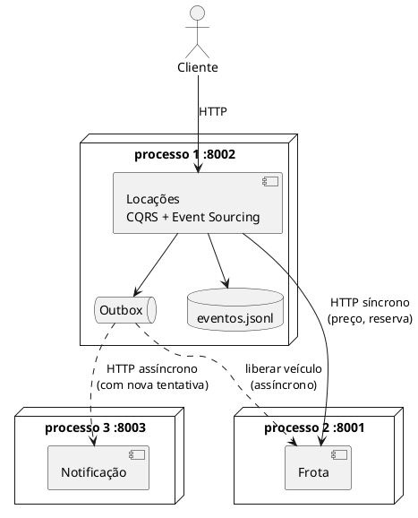

# Tutorial — Aula 22: Microsserviços e Arquiteturas Distribuídas  

**Projeto e Engenharia de Software** · UA5 — Projeto e Arquitetura de Software · Prof. Giovane Barcelos  
**Slides:** `Aula_22_Microservicos_Arquiteturas_Distribuidas` · **Duração estimada:** 3h em sala + extraclasse · **Workspace:** [`ua5-workspace/`](https://github.com/giovanebarcelos/pes-sandbox/tree/main/ua5-workspace)  

## O que você vai construir  

A mesma Locadora, publicada de **três jeitos**, para você decidir com base no que **viu funcionando**, e não no que leu:  

1. **Monolito modular:** um processo, módulos com fronteiras verificadas por teste (Frota, Locações e um novo módulo de Pagamentos).  
2. **Microkernel:** pagamentos com **plugins** (PIX, cartão... e o boleto que você vai escrever) sem alterar o núcleo.  
3. **Microsserviços:** Frota, Locações e Notificação em **três processos** que conversam por HTTP/JSON, com uma chamada **síncrona** (Frota) e uma **assíncrona** (Notificação, via *outbox*). Você vai **derrubar serviços de propósito** e observar o que acontece.  

Tudo só com a biblioteca padrão do Python: sem Flask, sem RabbitMQ, sem Kubernetes. O Docker Compose é **alternativa**: o caminho principal são três terminais.  



## De onde vêm os dados desta aula  

| O que | Origem |  
|---|---|  
| Contextos Frota e Locações, `FrotaAPI`, agregado `Locacao`, event store, projeções | **Aula 21** — `aula22/inicio` = `aula21/solucao` |  
| Porta `ServicoFrota` + adaptador `FrotaLocal` (Camada Anticorrupção) | **Aula 21**, Passo 10, e agora ganha o irmão `FrotaHttp` |  
| Regra de Dependência e teste de fronteiras com `ast` | **Aula 20**, Passo 10, e **Aula 21**, Passo 14 |  
| Observer / barramento de eventos (vira gatilho do outbox) | **Aulas 18, 19 e 21** |  
| Factory Method no renderizador SDUI | **Aula 18**, e `repository/class22/python/PES2204-SDUIRenderer.py` |  
| Formato de ADR | **Aula 18**, Slides 33-34 |  
| **O que sai daqui** | ADR de deploy + `AGENTS.md` atualizado, que são insumos da **A3** |  

## Mapa do tutorial  

| Passo | Assunto | Slides |  
|---|---|---|  
| 0 | Preparar o ambiente | — |  
| 1 | Já temos um monolito modular? | 10-12 |  
| 2 | Microkernel: pagamentos com plugins | 13-15 |  
| 3 | Camada Anticorrupção: traduzir erros antes da rede | 22-23 |  
| 4 | Extraindo a Frota como microsserviço | 7-9, 22 |  
| 5 | `FrotaHttp`: a mesma porta, agora pela rede | 9, 21 |  
| 6 | Notificação + Outbox (assíncrono) | 19-21 |  
| 7 | O serviço de Locações | 7, 22-23 |  
| 8 | Subir os três serviços (local ou Docker) | — |  
| 9 | Conversar com os serviços | 25 |  
| 10 | Experimentos de falha: síncrono × assíncrono | 20, 35, 40 |  
| 11 | Testes de integração e de contrato | 23, 40 |  
| 12 | Bônus: a tela vem do servidor (SDUI) | 24-31 |  
| 13 | Decidir a arquitetura de deploy + ADR | 32-36, 38 |  
| 14 | `AGENTS.md` da unidade | 43 |  
| 🤖 | Com o Agente | 43 |  

---  

## Passo 0 — Preparar o ambiente  

### Opção A (principal): local  

Na pasta `ua5-workspace/`:  

```bash
python ferramentas/verificar.py 22
python ferramentas/preparar.py 22            # ou: --da-minha (parte da sua aula21/meu)
cd aula22/meu
python -m unittest -v
```

✅ **Confira:** `Ran 18 tests ... OK`, que são os testes da Aula 21.  

> **Linux/macOS:** `python3` no lugar de `python`. Neste tutorial você vai precisar de **até 4 terminais** abertos em `aula22/meu`: no VS Code, use **Terminal → Split Terminal**.  

### Opção B (alternativa): Docker  

```bash
docker compose run --rm aula22                     # testes
docker compose --profile aula22 up                 # frota, locações e notificação (3 contêineres)
docker compose run --rm aula22-demo                # cliente de demonstração (outro terminal)
docker compose stop notificacao                    # experimento de falha (Passo 10)
docker compose --profile aula22 down -v            # para tudo e apaga os dados
```

Sua versão: `PASTA=meu docker compose ...` (Linux/macOS) ou `$env:PASTA="meu"; docker compose ...` (PowerShell).  

---  

## Passo 1 — Já temos um monolito modular?  

Um **monolito modular** é um único deploy com módulos que **só conversam por interfaces públicas** (Slide 11). Releia o que você fez na Aula 21:  

| Característica do monolito modular | Temos? | Onde |  
|---|---|---|  
| Módulos com responsabilidade de negócio clara | | |  
| Interface pública por módulo | | |  
| Proibição de acessar o "miolo" do outro módulo | | |  
| Comunicação por eventos entre módulos | | |  
| Um único processo e um único deploy | | |  

<details>  
<summary>Resposta</summary>  

Sim para todas: `frota/` e `locacoes/`; `FrotaAPI` e a porta `ServicoFrota`; `tests/test_fronteiras.py`; `VeiculoDevolvido` → liberar; `python -m locadora.main`. **A Aula 21 já entregou um monolito modular**, e é por isso que extrair um microsserviço hoje vai ser fácil.  

</details>  

---  

## Passo 2 — Microkernel: pagamentos com plugins  

**Atividade do Slide 38, item 2.** Formas de pagamento mudam o tempo todo (PIX, cartão, boleto, carteira digital...). No **Microkernel**, o núcleo define o **contrato** e **descobre** os plugins; cada forma de pagamento é um arquivo.  

1. Crie o módulo:  

   ```bash
   python -c "import os; [os.makedirs(p, exist_ok=True) or open(os.path.join(p,'__init__.py'),'a').close() for p in ['locadora/pagamentos','locadora/pagamentos/plugins']]"
   ```

2. `locadora/pagamentos/nucleo.py`, com o contrato, a descoberta automática e o registro:  

   ```python
   import importlib
   import pkgutil
   from abc import ABC, abstractmethod


   class PluginPagamento(ABC):
       nome = "?"

       @abstractmethod
       def taxa(self, valor):
           """Taxa cobrada pela forma de pagamento, em reais."""

       @abstractmethod
       def pagar(self, valor, referencia):
           """Processa o pagamento e devolve um texto de comprovante."""


   class SistemaPagamentos:
       def __init__(self):
           self._plugins = {}

       def registrar(self, plugin):
           if not isinstance(plugin, PluginPagamento):
               raise TypeError(f"{plugin!r} não segue o contrato PluginPagamento")
           self._plugins[plugin.nome] = plugin

       def descobrir(self, pacote="locadora.pagamentos.plugins"):
           modulo_pacote = importlib.import_module(pacote)
           for info in pkgutil.iter_modules(modulo_pacote.__path__):
               modulo = importlib.import_module(f"{pacote}.{info.name}")
               if hasattr(modulo, "PLUGIN"):
                   self.registrar(modulo.PLUGIN)
           return self

       def formas(self):
           return sorted(self._plugins)

       def pagar(self, forma, valor, referencia):
           try:
               plugin = self._plugins[forma]
           except KeyError:
               raise ValueError(f"Forma de pagamento não suportada: {forma}. "
                                f"Aceitas: {self.formas()}") from None
           total = round(valor + plugin.taxa(valor), 2)
           return total, plugin.pagar(total, referencia)
   ```

3. Dois plugins. `locadora/pagamentos/plugins/pix.py`:  

   ```python
   from ..nucleo import PluginPagamento


   class Pix(PluginPagamento):
       nome = "pix"

       def taxa(self, valor):
           return 0.0

       def pagar(self, valor, referencia):
           return f"PIX recebido: R$ {valor:.2f} (ref. {referencia})"


   PLUGIN = Pix()
   ```

   Faça o `cartao.py` com taxa de 3% (`round(valor * 0.03, 2)`).  

4. ✅ **Confira:**  

   ```bash
   python -c "from locadora.pagamentos.nucleo import SistemaPagamentos as S; s=S().descobrir(); print(s.formas(), s.pagar('cartao', 660, 'L-1'))"
   ```

   Saída: `['cartao', 'pix'] (679.8, 'Cartão aprovado: R$ 679.80 (ref. L-1)')`.  

5. **Exercício: o boleto.** Crie `plugins/boleto.py` com taxa fixa de R$ 3,50 **sem tocar em `nucleo.py`**. Rode o comando do item 4 de novo: `boleto` aparece sozinho na lista. Esse é o OCP da Aula 18, agora no nível da **arquitetura**.  

6. Copie `aula22/solucao/tests/test_plugins.py` e o `test_fronteiras.py` atualizado (ele ganhou `test_pagamentos_e_um_modulo_independente`).  

---  

## Passo 3 — Camada Anticorrupção: traduzir erros antes da rede  

Hoje, quando a Frota diz "já alugado", Locações recebe um `VeiculoIndisponivel` **da Frota**. Pela rede não chega exceção Python: chega um **código HTTP**. Para que o resto de Locações não perceba a diferença, os **dois** adaptadores (local e HTTP) devem lançar erros **de Locações**.  

1. Acrescente ao fim de `locacoes/dominio/erros.py`:  

   ```python
   class VeiculoDesconhecido(LocacaoErro, KeyError):
       pass


   class VeiculoNaoDisponivel(LocacaoErro, RuntimeError):
       pass


   class FrotaForaDoAr(LocacaoErro):
       """A Frota não respondeu (rede, timeout, serviço parado)."""
   ```

2. Faça o `FrotaLocal` traduzir. Ele continua **sem importar a Frota**: como os erros da Frota herdam de `KeyError`/`RuntimeError` (decisão da Aula 18!), basta capturar esses tipos. Copie `aula22/solucao/locadora/locacoes/adaptadores/frota_local.py`.  

3. Em `tests/test_cqrs_event_store.py`, troque o import e o `assertRaises(VeiculoIndisponivel)` por `VeiculoNaoDisponivel`, de `locadora.locacoes.dominio.erros`.  

4. Em `config.py`, acrescente o parâmetro `liberar_por_evento=True` a `montar()` e o `if` em volta da linha `barramento.inscrever(VeiculoDevolvido, ...)`. Copie da solução. Nos microsserviços, quem libera o veículo será o *outbox*.  

✅ **Confira:** `python -m unittest -v` verde.  

---  

## Passo 4 — Extraindo a Frota como microsserviço  

```bash
python -c "import os; os.makedirs('servicos', exist_ok=True); open('servicos/__init__.py','a').close()"
```

1. Copie `aula22/solucao/servicos/http_json.py`, um mini-framework de ~70 linhas sobre `http.server`. Ele traz rotas com expressões regulares, corpo e resposta em JSON e um erro 500 que **não derruba o serviço**. Leia `Rotas.despachar` e `criar_servidor`.  

2. Copie `servicos/frota_servico.py`. Ele **embrulha a `FrotaAPI` da Aula 21**, sem mudar uma linha do domínio:  

   | Rota | O que faz | Erros |  
   |---|---|---|  
   | `GET /saude` | "estou vivo" | — |  
   | `GET /v1/veiculos` | lista a frota | — |  
   | `GET /v1/veiculos/{placa}/preco?dias=N` | preço-base | 404 |  
   | `POST /v1/veiculos/{placa}/reserva` | reserva | 404, **409** se já alugado |  
   | `DELETE /v1/veiculos/{placa}/reserva` | libera | 404 |  

   Repare no **`/v1/`**: é o **versionamento de contrato** (Slide 23). Uma mudança incompatível vira `/v2/`, sem quebrar quem usa a `/v1/`.  

3. Suba o serviço (**terminal 1**):  

   ```bash
   python -m servicos.frota_servico
   ```

4. Converse com ele (**terminal 2**). Copie também `servicos/chamar.py`, um "curl" que funciona igual no Windows, Linux e macOS:  

   ```bash
   python -m servicos.chamar GET  http://localhost:8001/v1/veiculos
   python -m servicos.chamar GET  "http://localhost:8001/v1/veiculos/ABC-1234/preco?dias=5"
   python -m servicos.chamar POST http://localhost:8001/v1/veiculos/ABC-1234/reserva
   python -m servicos.chamar POST http://localhost:8001/v1/veiculos/ABC-1234/reserva
   ```

   ✅ **Confira:** preço `660.0`; a primeira reserva dá `HTTP 200`, a segunda `HTTP 409`. O navegador também funciona para os `GET`: abra http://localhost:8001/v1/veiculos.  

   Pare a Frota com **Ctrl+C** antes de seguir. Os dados ficam em memória: ao subir de novo, tudo volta disponível.  

---  

## Passo 5 — `FrotaHttp`: a mesma porta, agora pela rede  

Copie `aula22/solucao/locadora/locacoes/adaptadores/frota_http.py` e compare com `frota_local.py`:  

| | `FrotaLocal` (monolito) | `FrotaHttp` (microsserviço) |  
|---|---|---|  
| Implementa | `ServicoFrota` | `ServicoFrota` |  
| `preco_base` | chama um método | `GET /v1/veiculos/{placa}/preco` |  
| "Não existe" | `KeyError` → `VeiculoDesconhecido` | HTTP 404 → `VeiculoDesconhecido` |  
| "Já alugado" | `RuntimeError` → `VeiculoNaoDisponivel` | HTTP 409 → `VeiculoNaoDisponivel` |  
| Erro **novo** | — | timeout ou recusa → **`FrotaForaDoAr`** |  
| Latência | nanossegundos | milissegundos (`timeout=2.0`) |  

A última coluna tem **duas linhas que não existiam** no monolito: **a rede falha e a rede demora**. São as "falácias da computação distribuída", e todo o resto deste tutorial é sobre lidar com elas.  

> 💡 O `ManipuladorComandos` da Aula 21 **não muda**. É o retorno do investimento em Hexagonal (Aula 20) + Camada Anticorrupção (Aula 21).  

---  

## Passo 6 — Notificação + Outbox (assíncrono)  

**Atividade do Slide 38, item 3:** *síncrono ou assíncrono entre Locações e Notificação?* Pense antes: **se o e-mail estiver fora do ar, o cliente deve ficar sem o carro?**  

1. Copie `servicos/notificacao_servico.py`. Repare que ele é **idempotente**: guarda os `id`s recebidos e ignora repetições. Na entrega assíncrona, a mesma mensagem **pode chegar duas vezes** (o envio deu certo, mas a resposta se perdeu e o remetente tentou de novo).  

2. Copie `servicos/outbox.py`. A ideia, em quatro linhas:  

   ```
   1. o caso de uso grava "o que precisa ser avisado" numa fila LOCAL e responde ao usuário na hora;
   2. uma thread em segundo plano tenta entregar a cada 1 segundo;
   3. deu certo → remove da fila; deu erro → fica para a próxima rodada;
   4. resultado: Notificação fora do ar NÃO impede uma locação (sem falha em cascata).
   ```

> ⚠️ **Simplificação didática:** num sistema real, a fila do outbox fica **no mesmo banco**, gravada na **mesma transação** dos eventos. Aqui ela fica em memória: se Locações reiniciar com mensagens pendentes, elas se perdem. Anote isso no seu ADR como "consequência conhecida".  

---  

## Passo 7 — O serviço de Locações  

Copie `servicos/locacoes_servico.py` e encontre as três peças:  

1. **`montar_servico()`**: usa o `montar()` da Aula 21, mas passando `FrotaHttp(url)` e `liberar_por_evento=False`. **Não há Frota local** neste processo.  
2. **`ligar_outbox()`**: assina os eventos do barramento (`LocacaoIniciada`, `VeiculoDevolvido`, `MultaPorAtrasoAplicada`) e transforma cada um numa tarefa do outbox. Até o "liberar veículo" na devolução virou assíncrono: a devolução **já aconteceu** e não deve falhar só porque a Frota está fora do ar naquele segundo.  
3. **`criar_rotas()`**: traduz erros de domínio em HTTP (**404** veículo desconhecido, **409** indisponível, **503** Frota fora do ar, **400** dados inválidos).  

| Rota | Lado do CQRS |  
|---|---|  
| `POST /v1/locacoes` | escrita (comando `IniciarLocacao`) |  
| `POST /v1/locacoes/{id}/devolucao` | escrita (comando `RegistrarDevolucao`) |  
| `GET /v1/locacoes/ativas` | leitura (projeção) |  
| `GET /v1/relatorios/faturamento?mes=AAAA-MM` | leitura (projeção) |  
| `GET /v1/relatorios/mais-alugados?mes=AAAA-MM` | leitura (projeção) |  
| `GET /v1/outbox` | observabilidade: o que ainda não foi entregue |  

Copie também `servicos/iniciar_todos.py` e `servicos/demo_cliente.py`.  

---  

## Passo 8 — Subir os três serviços  

### Opção A (principal): três terminais, um serviço em cada  

Assim você pode derrubar **um** serviço de cada vez no Passo 10. Todos em `aula22/meu`:  

```bash
# terminal 1
python -m servicos.frota_servico
# terminal 2
python -m servicos.notificacao_servico
# terminal 3
python -m servicos.locacoes_servico
```

✅ **Confira:** cada terminal mostra `[nome] ouvindo em http://localhost:800X`. O terminal 3 cria `dados/eventos.jsonl` (o event store **deste serviço**: "um serviço, um banco", Slide 40).  

### Atalho: um terminal só  

```bash
python -m servicos.iniciar_todos
```

Sobe os três como processos separados e encerra todos com **Ctrl+C**. É prático para a demo, mas não serve para os experimentos de falha.  

### Opção B (alternativa): Docker Compose  

Na pasta `ua5-workspace/`:  

```bash
docker compose --profile aula22 up
```

São três contêineres na mesma rede. Locações encontra a Frota por **nome** (`http://frota:8001`, veja `FROTA_URL` no `docker-compose.yml`), e não por `localhost`: cada contêiner tem o seu próprio `localhost`.  

---  

## Passo 9 — Conversar com os serviços  

Num **quarto terminal** (em `aula22/meu`):  

```bash
python -m servicos.demo_cliente
```

(com Docker: `docker compose run --rm aula22-demo`)  

✅ **Saída esperada (resumo):**  

```
2) Alugar ABC-1234 por 5 dias (Locações -> Frota, SÍNCRONO):
   (201, {'id': 'L-xxxx', 'placa': 'ABC-1234', 'valor_previsto': 660.0})
3) Tentar alugar o mesmo veículo de novo (erro 409 vindo da Frota):
   (409, {'erro': 'Veículo ABC-1234 já está alugado'})
4) Devolver com 2 dias de atraso:
   (200, {'id': 'L-xxxx', 'multa': 396.0, 'valor_total': 1056.0})
5) Notificações recebidas pelo serviço de Notificação:
   - Locação L-xxxx do ABC-1234 confirmada: R$ 660.00 por 5 dia(s).
   - Veículo ABC-1234 devolvido (locação L-xxxx).
   - Multa por 2 dia(s) de atraso: R$ 396.00.
```

Olhe os **logs** nos três terminais: dá para seguir uma requisição passando por Locações → Frota → (depois) Notificação. Em produção, isso é feito com *tracing distribuído* (Slide 40: "observabilidade desde o início").  

Faça chamadas à mão também:  

```bash
python -m servicos.chamar POST http://localhost:8002/v1/locacoes placa=DEF-5678 cliente=Bia dias=3
python -m servicos.chamar GET  http://localhost:8002/v1/locacoes/ativas
python -m servicos.chamar GET  "http://localhost:8002/v1/relatorios/mais-alugados?mes=2026-11"
```

---  

## Passo 10 — Experimentos de falha: síncrono × assíncrono  

Este é o passo mais importante da aula. Anote o que observar.  

### Experimento A: Notificação fora do ar (assíncrono)  

1. No **terminal 2**, pare a Notificação (**Ctrl+C**).  
2. Alugue um veículo:  

   ```bash
   python -m servicos.chamar POST http://localhost:8002/v1/locacoes placa=XYZ-9012 cliente=Caio dias=2
   ```

   ✅ `HTTP 201`: **a locação funcionou**.  
3. Espere 2 segundos e veja a fila:  

   ```bash
   python -m servicos.chamar GET http://localhost:8002/v1/outbox
   ```

   ✅ A mensagem está em `pendentes`, e `ultimo_erro` mostra a recusa de conexão. Se aparecer `null`, o entregador ainda não tentou: repita o comando.  
4. Suba a Notificação de novo (`python -m servicos.notificacao_servico`) e espere 1 a 2 segundos.  

   ✅ A mensagem aparece no terminal 2, e `GET /v1/outbox` volta vazio.  

### Experimento B: Frota fora do ar (síncrono)  

1. No **terminal 1**, pare a Frota (**Ctrl+C**).  
2. Tente alugar:  

   ```bash
   python -m servicos.chamar POST http://localhost:8002/v1/locacoes placa=CAM-0001 cliente=Davi dias=1
   ```

   ✅ `HTTP 503` com `"Frota inacessível..."`: **falha visível e rápida**, e **nada foi gravado** (confira `GET /v1/locacoes/ativas`).  
3. Suba a Frota de novo. ⚠️ Ela volta **com a memória zerada** (todos os veículos disponíveis), mas o event store de Locações ainda tem locações ativas. **Os dois serviços discordam.** Esse é o custo real de "cada serviço com o seu banco": é preciso pensar em **consistência entre serviços** (sagas, reconciliação), assunto que não cabe nesta aula, mas que deve aparecer no seu ADR.  

### Perguntas para responder  

| Pergunta | Sua resposta |  
|---|---|  
| Por que a reserva na Frota **não pode** ser assíncrona? | |  
| Por que a notificação **pode**? | |  
| O que aconteceria se a notificação fosse síncrona e a Notificação caísse? | |  
| Por que a Notificação precisa ser idempotente? | |  
| No monolito modular, algum desses problemas existe? | |  

---  

## Passo 11 — Testes de integração e de contrato  

Pare os serviços e copie `aula22/solucao/tests/test_servicos.py`. Ele **sobe os três servidores dentro do teste**, em portas livres, e automatiza o Passo 10:  

| Teste | Prova que |  
|---|---|  
| `test_fluxo_completo_entre_servicos` | aluguel → 409 → devolução com multa → 3 notificações → frota liberada |  
| `test_contrato_de_erros` | 404, 400 e rota inexistente respondem como documentado (contrato) |  
| `test_frota_fora_do_ar_responde_503` | falha síncrona é visível |  
| `test_notificacao_fora_do_ar_nao_impede_locacao` | falha assíncrona é absorvida pelo outbox |  
| `test_notificacao_idempotente` | mensagem repetida não gera aviso duplicado |  

```bash
python -m unittest -v
```

✅ **Confira:** `Ran 30 tests ... OK` (leva alguns segundos por causa dos servidores).  

> 💡 **Contract testing** (Slide 40): `test_contrato_de_erros` é a versão mínima. Em times separados, o **consumidor** (Locações) escreve o que espera da Frota, e a **Frota** roda esses testes antes de cada deploy.  

---  

## Passo 12 — Bônus: a tela vem do servidor (SDUI)  

Com a Frota no ar, abra http://localhost:8001/v1/telas/frota. O servidor não manda **dados**: manda a **tela** (uma árvore de componentes `column`, `text`, `button`, com a **ação** de cada botão descrita como dado). O `demo_cliente.py` a renderiza com uma função de ~10 linhas (`renderizar_sdui`).  

Pare a Frota, alugue um veículo, suba-a de novo e recarregue: a tela muda **sem mudar o cliente**. Compare com o renderizador completo em `repository/class22/python/PES2204-SDUIRenderer.py` (Factory Method + *fallback* para componente desconhecido) e releia os trade-offs do Slide 30: **por que a maioria dos sistemas NÃO usa SDUI?**  

---  

## Passo 13 — Decidir a arquitetura de deploy + ADR  

**Atividade do Slide 38, itens 1 e 4.** Agora que você viu os três funcionando, preencha com os critérios do Slide 34:  

| Critério | Monolito | Monolito modular | Microsserviços |  
|---|---|---|---|  
| Tamanho do time da Locadora | | | |  
| Deploy e operação | | | |  
| Falha de um módulo | | | |  
| Consistência dos dados | | | |  
| Escalar só Locações em feriados | | | |  
| Custo de mudar de ideia depois | | | |  

Escreva `docs/adr/0005-arquitetura-de-deploy.md` com **pelo menos duas alternativas rejeitadas** e os **gatilhos** que fariam você rever a decisão. Inclua a escolha síncrono/assíncrono do Passo 10. Compare com `aula22/solucao/docs/adr/0005-arquitetura-de-deploy.md` e com o diagrama de `aula22/solucao/docs/comunicacao.md`.  

> Para um projeto acadêmico, "microsserviços" é quase sempre **complexidade sem retorno** (Slide 35). Ter **feito** os microsserviços aqui não obriga a adotá-los: o que conta na nota da A3 é a **adequação ao problema**.  

---  

## Passo 14 — `AGENTS.md` da unidade  

A cada unidade, o `AGENTS.md` cresce (Aula 01B, Slide 33). Abra `ua5-workspace/AGENTS.md` e preencha a seção **Arquitetura**, uma linha por item:  

```markdown
## Arquitetura (acrescentado na Aula 22)
- Padrão: monolito modular (frota/, locacoes/, pagamentos/) com Hexagonal dentro de cada módulo; microsserviços em servicos/ só como experimento
- Decisões: aulaXX/solucao/docs/adr/ (0001 SOLID … 0005 deploy)
- Regra de dependência: dominio/ não importa aplicacao/, adaptadores/, sqlite3, json nem http; módulos só se falam por api.py/portas (tests/test_fronteiras.py)
```

Faça o mesmo no `AGENTS.md` do **seu projeto da A3**.  

### Checklist de entrega  

- [ ] Plugin de **boleto** funcionando sem alterar `nucleo.py`  
- [ ] Três serviços no ar e `demo_cliente` com as 3 notificações  
- [ ] Experimentos A e B feitos, com as 5 perguntas respondidas  
- [ ] `python -m unittest -v` verde (30 testes)  
- [ ] Tabela de critérios + ADR-0005 (com síncrono/assíncrono)  
- [ ] `AGENTS.md` com a seção Arquitetura  

---  

## 🤖 Com o Agente  

> **Primeiro à mão, depois o agente** (Aula 01B, Slide 32).  

**Setup:** o da **Aula 01B**, com `opencode` aberto em `ua5-workspace/`. A skill `grilling` foi instalada na Aula 01B; confira com `opencode debug skill`.  

> ⚠️ **Segurança (Aula 01B, Slide 31):** nesta aula o agente vai querer **subir servidores e matar processos**. O `opencode.json` do workspace pede confirmação (`"ask"`) para todo comando que não seja teste ou `git status/diff/log`. **Leia cada comando antes de aprovar**, principalmente `kill`, `taskkill` e `docker ... down -v`.  

### Prompts por passo  

| Passo | Modo | Prompt |  
|---|---|---|  
| 1 | plan | *"Avalie se aula22/meu/locadora é um monolito modular: quais módulos existem, qual a interface pública de cada um e onde as fronteiras são verificadas?"* |  
| 2 | build | *"Crie o plugin boleto em locadora/pagamentos/plugins/ com taxa fixa de R$ 3,50 e um teste. Não altere nucleo.py — se achar que precisa, me explique por quê antes."* |  
| 7 | plan | *"Revise servicos/locacoes_servico.py: que falhas de rede não estão tratadas? O que acontece com as mensagens do outbox se o processo reiniciar?"* |  
| 10 | plan | *"Explique, com base no código de aula22/meu/servicos, por que a reserva na Frota é síncrona e a notificação é assíncrona. Que problema aparece quando a Frota reinicia com a memória zerada?"* |  
| 13 | build | *"Use a skill grilling para me questionar sobre a arquitetura de deploy do projeto da A3 — monolito, monolito modular ou microsserviços —, usando os critérios do Slide 34 da Aula 22."* |  
| 13 | build | *"Desenhe em PlantUML os módulos do projeto e as interfaces entre eles, marcando o que é chamada síncrona e o que é mensagem assíncrona."* |  
| 13 | build | *"Rascunhe o ADR da escolha de deploy, com pelo menos duas alternativas rejeitadas e o motivo."* |  
| 14 | build | *"Acrescente ao AGENTS.md o padrão arquitetural adotado, a pasta docs/adr/ e a regra de dependência do domínio, em uma linha cada."* |  

### Você valida  

- **O limite da IA como copiloto** (Slide 36): confira a recomendação contra os critérios do Slide 34 (tamanho do time, domínio, operação). O agente **adora** microsserviços, Kafka e Kubernetes.  
- O agente vai sugerir `pip install flask requests` ou um broker de mensagens. **Recuse**: o `AGENTS.md` proíbe dependências, e a aula funciona em laboratório sem internet.  
- Se o agente "resolver" a falha da Notificação trocando o outbox por uma chamada direta com `try/except: pass`, a mensagem **se perde em silêncio**. Exija que fique pendente e seja reenviada (teste `test_notificacao_fora_do_ar_nao_impede_locacao`).  
- Confira se o diagrama PlantUML do agente **bate com o código** (portas, URLs, síncrono × assíncrono).  

### Registro  

| Prompt (resumo) | O que o agente acertou | O que errou ou omitiu | O que você corrigiu |  
|---|---|---|---|  
| | | | |  

---  

## Problemas comuns  

| Sintoma | Causa provável | Solução |  
|---|---|---|  
| `Address already in use` / `WinError 10048` | Serviço anterior ainda rodando | Feche o terminal antigo; no pior caso, reinicie o terminal do VS Code |  
| `Sem resposta de http://localhost:8001` | Frota não está no ar | Suba-a no terminal 1 |  
| Locações responde **503** com a Frota no ar | `FROTA_URL` errada (Docker: `http://frota:8001`; local: `http://localhost:8001`) | Confira a variável de ambiente |  
| `ConflitoDeConcorrencia` ao rodar a demo | `dados/eventos.jsonl` antigo com o mesmo id | Apague `dados/` (o `demo_cliente` usa ids aleatórios; isso ocorre com ids fixos) |  
| Notificação não chega | Outbox esperando o próximo ciclo (1 s) | `GET /v1/outbox` mostra `ultimo_erro` |  
| Antivírus ou firewall do Windows pergunta sobre o Python | O Python está abrindo portas de rede | Permita só em **redes privadas** |  
| Docker: `locacoes` sobe antes da `frota` | `depends_on` não espera o serviço ficar pronto | Não precisa fazer nada: a primeira chamada pode dar 503, e as seguintes funcionam |  

## Encerramento da UA5  

| Aula | O que a Locadora ganhou | Pasta |  
|---|---|---|  
| 18 | Do legado ao SOLID, Strategy, Factory Method e ADR | `aula18/solucao` |  
| 19 | MVC (terminal e web), MVP testável, MVVM com Observer | `aula19/solucao` |  
| 20 | Hexagonal, SQLite real e Regra de Dependência como teste | `aula20/solucao` |  
| 21 | Bounded contexts, Event Sourcing, CQRS e eventos entre contextos | `aula21/solucao` |  
| **22** | **Monolito modular, Microkernel, microsserviços com falhas observadas** | `aula22/solucao` |  

**A arquitetura certa é sempre a mais simples que resolve o problema real**, e agora você tem o vocabulário, o código e os testes para justificar essa escolha na **A3**.  
